# Panduan Pengguna — PLN Meeting Room & Booking Management

Pesan ruang rapat tanpa telepon, tanpa spreadsheet, tanpa jadwal bentrok.

Panduan ini membantu Anda memakai aplikasi dari langkah pertama sampai mahir. Pilih bagian sesuai peran Anda:

| Saya seorang… | Baca bagian |
|---|---|
| **Pengguna** (mengajukan booking ruangan) | [1](#1-mengenal-aplikasi) → [2](#2-memulai) → [3](#3-untuk-pengguna-mengajukan-dan-memantau-booking) → [7](#7-tanya-jawab-dan-pemecahan-masalah) |
| **Operator** (meninjau pengajuan) | [1](#1-mengenal-aplikasi) → [2](#2-memulai) → [4](#4-untuk-operator-meninjau-pengajuan) |
| **Admin** (mengelola sistem) | [1](#1-mengenal-aplikasi) → [2](#2-memulai) → [4](#4-untuk-operator-meninjau-pengajuan) → [5](#5-untuk-admin-mengelola-data-dan-sistem) → [6](#6-layar-display-signage) |

> **Tentang gambar:** Semua tangkapan layar memakai data contoh (nama, email, dan dokumen fiktif). Tampilan di aplikasi Anda akan menyesuaikan data yang ada. Sebagian label aplikasi berbahasa Inggris dan sebagian berbahasa Indonesia. Panduan ini menulisnya persis seperti yang tampil di layar.

---

## 1. Mengenal Aplikasi

### Apa yang bisa Anda lakukan?

- **Mengajukan pemakaian ruang rapat** lengkap dengan tanggal, jam, pimpinan acara, dan dokumen pendukung.
- **Memantau status pengajuan** secara langsung: menunggu, disetujui, atau ditolak.
- **Menerima notifikasi** di dalam aplikasi begitu ada perkembangan.
- **Melihat jadwal acara** yang sedang dan akan berlangsung.
- **Menampilkan jadwal di layar** lobi, depan ruangan, dan layar informasi lain.

### Peran dan hak akses

Setiap akun punya satu peran. Akun dibuat oleh Admin, jadi Anda tidak perlu mendaftar sendiri.

| Kemampuan | Pengguna | Operator | Admin |
|---|:---:|:---:|:---:|
| Mengajukan booking (**Book Room**) | ✅ | — | — |
| Melihat booking | Milik sendiri | Semua | Semua |
| Menyetujui / menolak booking | — | ✅ | ✅ |
| Mengubah / menghapus booking | — | — | ✅ |
| Melihat statistik di Dashboard | — | ✅ | ✅ |
| Mengelola data master (gedung, ruangan, dll.) | — | — | ✅ |
| Mengelola akun pengguna | — | — | ✅ |
| Mengatur sistem | — | — | ✅ |
| Notifikasi & pengaturan akun sendiri | ✅ | ✅ | ✅ |

> **Catatan:** Tidak tahu peran Anda? Lihat menu di sisi kiri. Jika grup **Master** muncul, berarti Anda Admin.

### Status booking

| Status | Artinya | Langkah Anda |
|---|---|---|
| 🟡 **Pending** | Pengajuan sudah masuk dan menunggu ditinjau. Jadwalnya sudah *dikunci*, sehingga tidak ada orang lain yang bisa memesan ruangan yang sama di jam itu. | Tunggu notifikasi. |
| 🟢 **Approved** (Disetujui) | Pengajuan disetujui. Acara muncul di jadwal dan layar display. | Siapkan acara Anda. |
| 🔴 **Rejected** (Ditolak) | Pengajuan tidak disetujui. Alasannya tertulis di kolom **Keterangan** pada halaman detail. | Baca alasannya, lalu ajukan ulang dengan perbaikan. |

> Pada data tertentu Anda mungkin juga melihat label abu-abu **Cancelled**. Status ini tidak bisa Anda buat sendiri dari aplikasi.

---

## 2. Memulai

### Masuk ke aplikasi

1. Buka alamat aplikasi di browser (Chrome, Edge, atau Firefox versi terbaru).
2. Isi **Email address** dan **Password**.
3. Centang **Remember me** jika Anda memakai perangkat pribadi dan ingin tetap masuk.
4. Klik **Log in**.

Anda akan langsung diarahkan ke **Dashboard**.

> **Tips:** Setelah beberapa kali salah memasukkan email atau password, login dikunci sementara (batas 5 kali per menit). Tunggu semenit lalu coba lagi.

> **Lupa password?** Aplikasi ini belum menyediakan fitur reset mandiri. Hubungi Admin untuk mendapatkan password baru, lalu ganti sendiri lewat halaman **Security** di [Pengaturan akun](#pengaturan-akun).

### Khusus Operator dan Admin: pengingat pengajuan

Selama masih ada pengajuan yang menunggu, dialog **Butuh tindakan.** muncul setiap kali Anda membuka atau memuat ulang halaman: *"Ada N bookings yang belum di tindak lanjuti."*

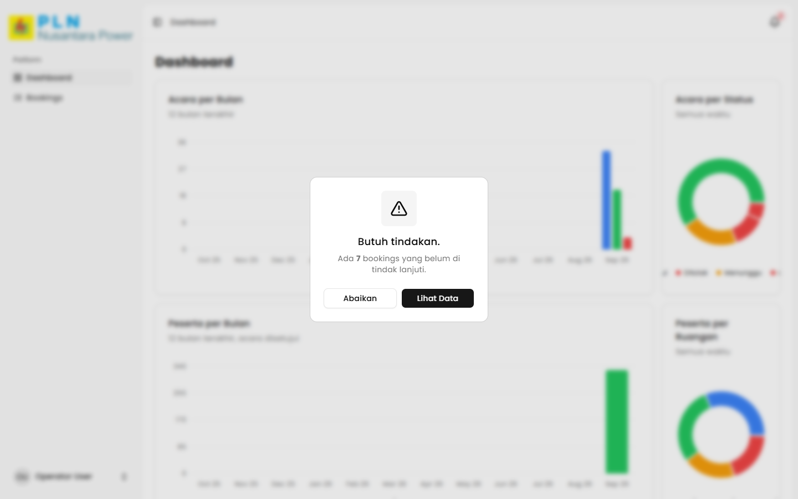

- Klik **Lihat Data** untuk langsung membuka daftar booking berstatus Pending.
- Klik **Abaikan** untuk menutupnya dan melanjutkan pekerjaan.

### Mengenal tata letak

- **Menu samping (kiri):**
  - Grup **Patform**: **Dashboard** dan **Bookings**. (Ya, ejaannya memang begitu di layar.)
  - Grup **Master** (khusus Admin): Gedung, Ruangan, Kelompok Ruangan, Level Keamanan, Pimpinan Acara, Pengguna, Infografis, Pengaturan Sistem.
- **Ikon lonceng (kanan atas):** notifikasi Anda. Angka merah menunjukkan jumlah yang belum dibaca.
- **Menu akun (bagian bawah menu samping):** klik nama Anda untuk membuka **Profile**, **Security**, **Appearance**, dan **Log out**.

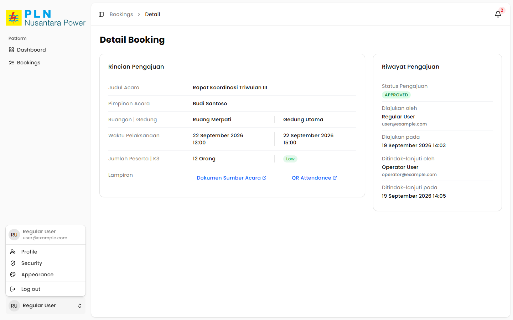

### Keluar dari aplikasi

Buka menu akun di bagian bawah menu samping, lalu klik **Log out**. Selalu keluar jika Anda memakai komputer bersama.

---

## 3. Untuk Pengguna: Mengajukan dan Memantau Booking

### Membaca Dashboard

**Dashboard** adalah halaman pertama Anda. Isinya:

- **Total Booking**: seluruh pengajuan Anda.
- **Pending**: yang menunggu ditinjau.
- **Disetujui**: yang sudah disetujui.
- **Ditolak**: yang tidak disetujui.
- **Jadwal Acara Kedepan**: semua acara *disetujui* yang sedang dan akan berlangsung (tidak hanya milik Anda). Gunakan kotak **Cari agenda atau ruangan...** untuk mencari.

> **Tips:** Sebelum mengajukan, cek dulu **Jadwal Acara Kedepan**. Ini cara cepat melihat ruangan mana yang sudah terisi.

### Mengajukan booking ruangan

**Siapkan dulu (agar sekali jalan):**

- Judul acara dan jumlah peserta.
- Nama pimpinan acara.
- **Dokumen sumber acara**, misalnya surat undangan atau nota dinas. Format PDF, JPG, atau PNG, maksimal **10 MB**.
- **Gambar QR Attendance** untuk absensi peserta. Format gambar, maksimal **5 MB**.

**Langkah-langkah:**

1. Buka menu **Bookings**.
2. Klik **Book Room** (pojok kanan atas). Formulir akan terbuka.

   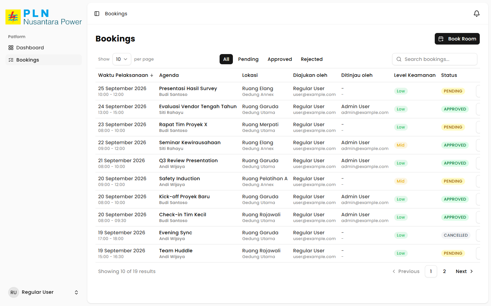

3. Isi seluruh kolom, lihat tabel di bawah.

   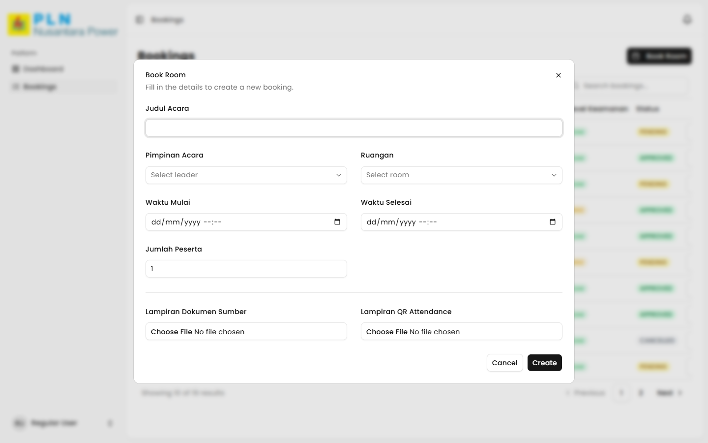

4. Klik **Create**.
5. Bila berhasil, muncul pesan *"Booking created successfully."* dan pengajuan Anda tampil di daftar dengan status **Pending**.

   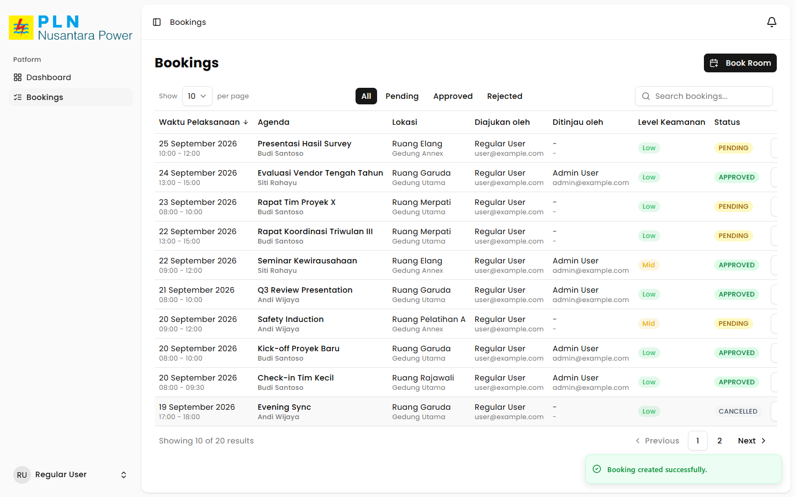

> Tombol **Book Room** hanya muncul untuk akun berperan Pengguna.

**Isi formulir:**

| Kolom | Wajib | Cara mengisi |
|---|:---:|---|
| **Judul Acara** | ✅ | Nama acara, maksimal 200 karakter. Buat spesifik, misalnya *"Rapat Koordinasi Triwulan III"*. |
| **Pimpinan Acara** | ✅ | Klik kolom, lalu ketik atau pilih nama dari daftar. Jika nama tidak ada, minta Admin menambahkannya di menu **Pimpinan Acara**. |
| **Ruangan** | ✅ | Pilih ruangan. Kapasitas tampil di samping nama, misalnya *"Ruang Garuda (capacity: 20)"*. |
| **Waktu Mulai** | ✅ | Tanggal dan jam mulai. Lihat aturan waktu di bawah. |
| **Waktu Selesai** | ✅ | Harus setelah Waktu Mulai. |
| **Jumlah Peserta** | ✅ | Minimal 1. |
| **Lampiran Dokumen Sumber** | ✅ | PDF / JPG / PNG, maksimal 10 MB. |
| **Lampiran QR Attendance** | ✅ | File gambar, maksimal 5 MB. QR ini akan ditampilkan di layar depan ruangan pada hari acara agar peserta dapat memindainya. |

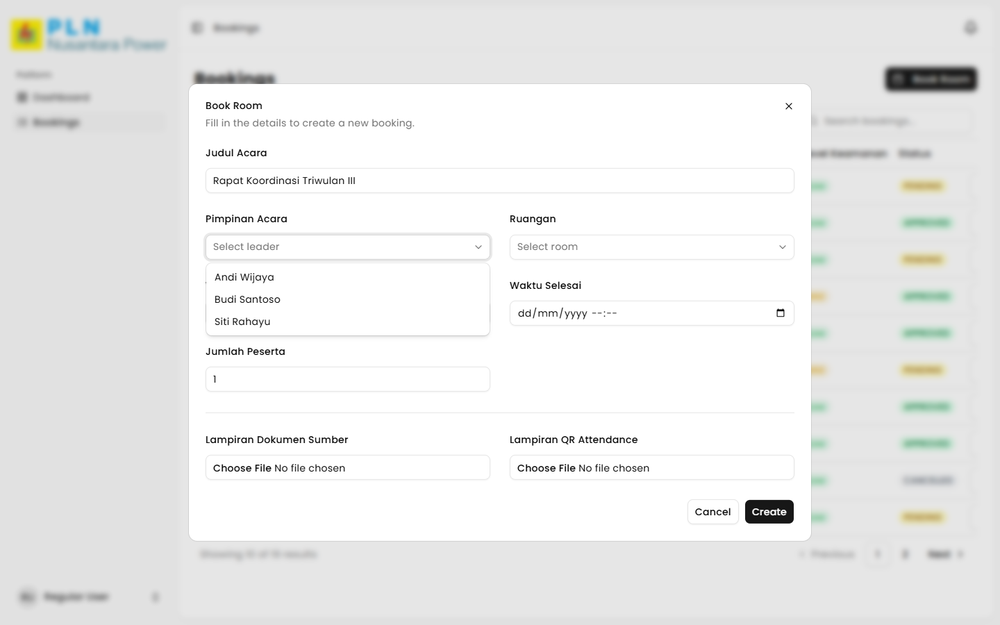

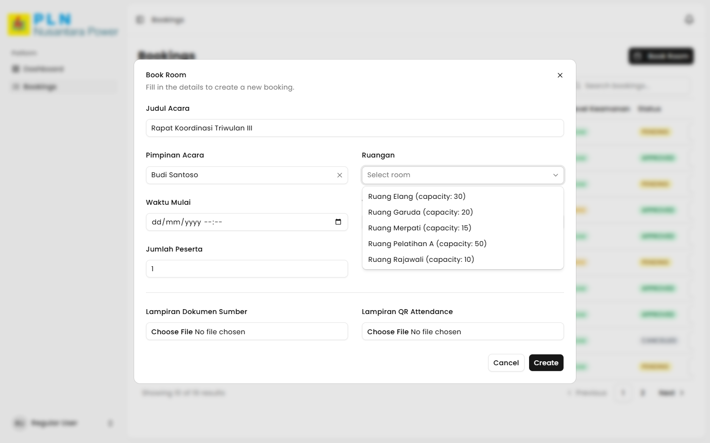

Contoh formulir yang sudah terisi lengkap dan siap dikirim:

> **Penting:** Aplikasi menampilkan kapasitas ruangan tetapi **tidak memblokir** jika jumlah peserta melebihi kapasitas. Pastikan sendiri ruangan cukup.

**Level Keamanan (K3) diisi otomatis.** Anda tidak perlu memilihnya. Aplikasi menentukannya dari Jumlah Peserta, dan hasilnya tampil sebagai label berwarna di daftar booking dan halaman detail. Contoh pengaturan bawaan: 1–20 peserta = Low, 21–50 = Mid, 51 ke atas = High. Admin dapat mengubah rentang ini.

**Aturan waktu yang perlu Anda tahu:**

| Aturan | Nilai bawaan | Keterangan |
|---|---|---|
| Ajukan minimal sebelum acara | **24 jam** | Waktu Mulai harus sedikitnya 24 jam dari sekarang. |
| Ajukan paling jauh | **30 hari** ke depan | Acara lebih jauh dari itu belum bisa diajukan. |
| Ruangan tidak boleh bentrok | — | Dicek terhadap booking **Pending** dan **Approved** di ruangan yang sama. Booking **Rejected** tidak menghalangi. |
| Batas kirim | 10 kali per menit | Cukup longgar untuk pemakaian normal. |

> **Tips:** Angka 24 jam dan 30 hari dapat diubah Admin. Jika pesan error menyebut angka lain, itulah aturan yang berlaku saat ini.

**Kalau muncul pesan error**, pesannya tampil merah di bawah kolom yang bermasalah dan sebagai notifikasi di pojok kanan bawah. Perbaiki kolom tersebut, lalu klik **Create** lagi. Isian lain Anda tidak hilang.

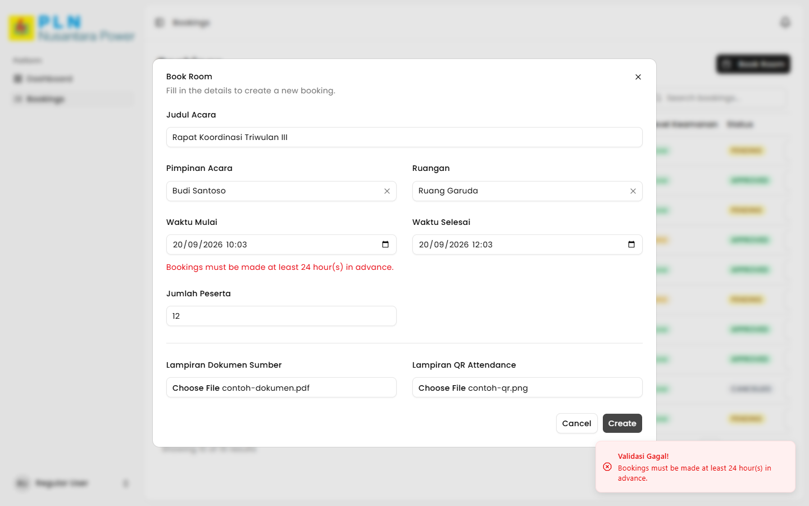

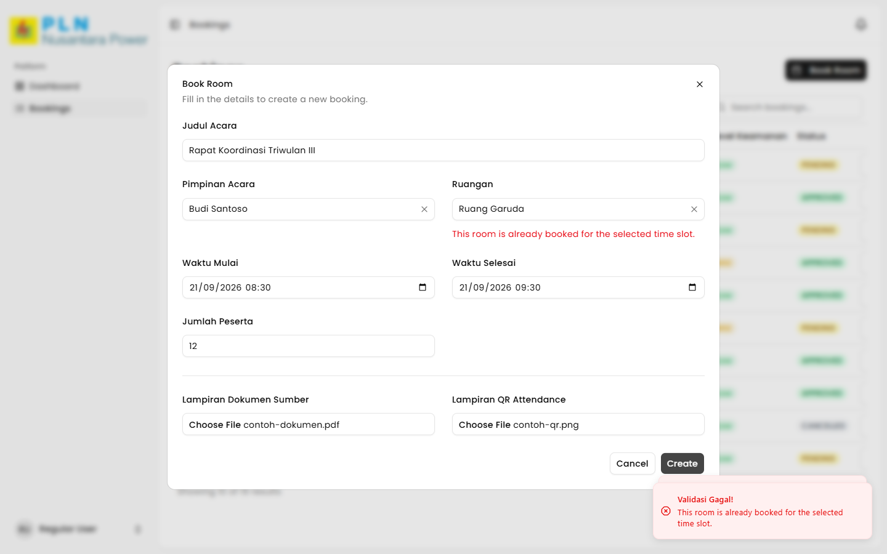

### Memantau pengajuan Anda

Buka **Bookings** untuk melihat semua pengajuan Anda.

**Menyaring dan mencari:**

- Tombol **All**, **Pending**, **Approved**, **Rejected** menyaring berdasarkan status.
- Kotak **Search bookings...** mencari berdasarkan judul acara atau nama ruangan.
- Klik judul kolom **Waktu Pelaksanaan** atau **Status** untuk mengurutkan.
- Pilih jumlah baris per halaman (**Show** 10, 25, 50, atau 100).

**Kolom yang tersedia:**

| Kolom | Isinya |
|---|---|
| **Waktu Pelaksanaan** | Tanggal dan jam acara |
| **Agenda** | Judul acara dan nama pimpinan |
| **Lokasi** | Ruangan dan gedung |
| **Diajukan oleh** | Nama dan email pemohon |
| **Ditinjau oleh** | Operator/Admin yang menindaklanjuti (`-` jika belum) |
| **Level Keamanan** | Label K3 |
| **Status** | Pending / Approved / Rejected |

### Melihat detail dan alasan penolakan

Klik judul acara, atau tombol panah (**›**) di ujung baris, untuk membuka **Detail Booking**.

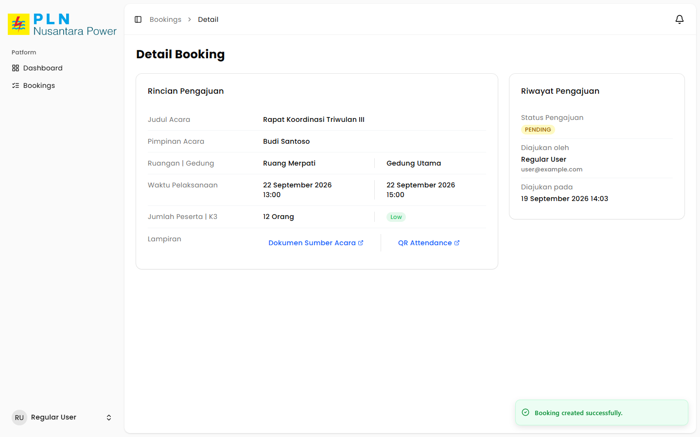

- **Rincian Pengajuan**: judul, pimpinan, ruangan dan gedung, waktu pelaksanaan, jumlah peserta dan level K3, serta lampiran.
- **Lampiran**: klik **Dokumen Sumber Acara** atau **QR Attendance** untuk melihat pratinjaunya tanpa meninggalkan halaman.
- **Riwayat Pengajuan**: status terkini, siapa yang mengajukan dan kapan, siapa yang menindaklanjuti dan kapan.
- **Keterangan**: muncul jika pengajuan **ditolak**, berisi alasan dari peninjau.

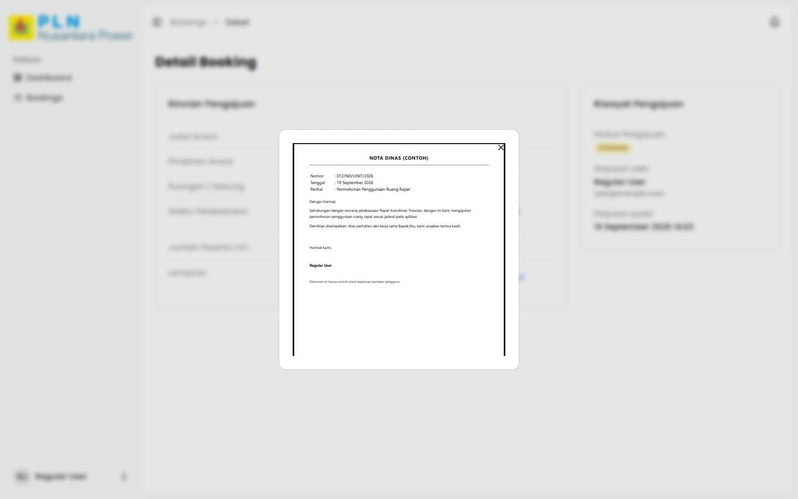

Setelah pengajuan disetujui, halaman detail memperlihatkan siapa yang menindaklanjuti dan kapan:

### Kalau pengajuan ditolak atau perlu diubah

- **Ditolak:** baca alasan di **Keterangan**, perbaiki (misalnya ganti jam, ruangan, atau dokumen), lalu ajukan ulang lewat **Book Room**.

  

- **Perlu diubah setelah diajukan:** Pengguna tidak dapat mengubah atau membatalkan booking sendiri. Hubungi Admin untuk perubahan, dan sebutkan judul acaranya.

### Notifikasi

Anda mendapat notifikasi di dalam aplikasi (tanpa email atau WhatsApp) ketika pengajuan Anda **disetujui** atau **ditolak**, lengkap dengan nama peninjau.

- Klik **ikon lonceng** untuk melihat notifikasi terbaru. Klik **View all** untuk membuka daftar lengkap.

  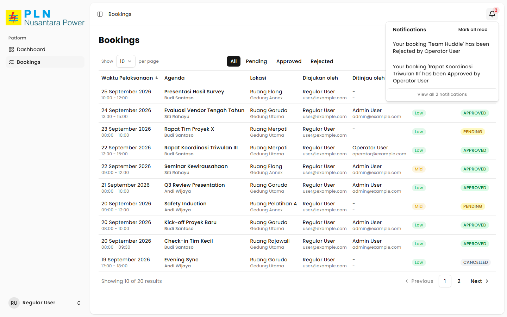

- Di halaman **Notifications**, **Mark all read** menandai semuanya sudah dibaca dan **Clear all** membersihkan daftar. Setiap notifikasi juga punya ikon centang (tandai dibaca) dan ikon tempat sampah (hapus).

  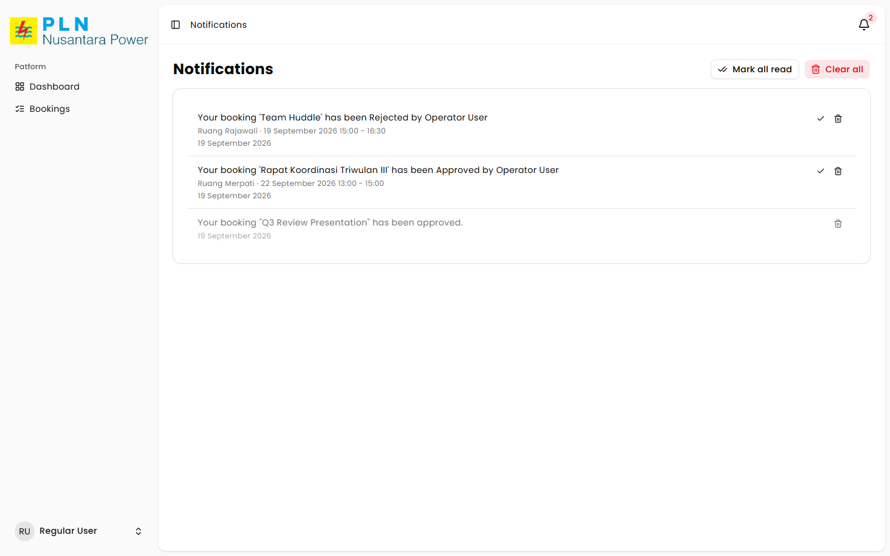

- Jika tab aplikasi sedang tidak Anda lihat, judul tab berkedip saat ada notifikasi baru.

### Pengaturan akun

Buka menu akun di bagian bawah menu samping, lalu klik **Profile**, **Security**, atau **Appearance**. Halaman **Settings** punya empat bagian di sisi kirinya:

| Halaman | Fungsinya |
|---|---|
| **Profile** | Ubah **Name** dan **Email address**, lalu klik **Save**. |
| **Security** | Ganti password: isi **Current password**, **New password**, dan **Confirm password**, lalu klik **Save**. |
| **Appearance** | Pilih tema tampilan: **Light**, **Dark**, atau **System** (mengikuti perangkat). |
| **Notification** | Pilih suara notifikasi pribadi. Unggah file audio (mp3, wav, ogg, m4a, aac, flac; maksimal 10 MB), coba dengan **Test Sound**, lalu klik **Save**. Setelah Anda punya audio pribadi, tombol **Gunakan audio bawaan** tersedia untuk kembali ke suara standar. |

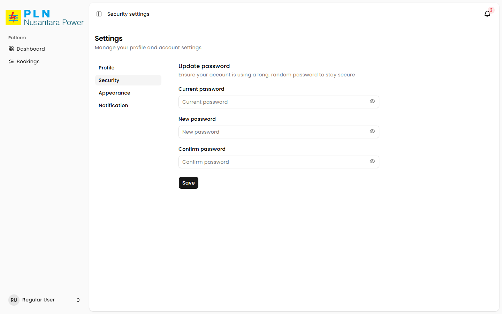

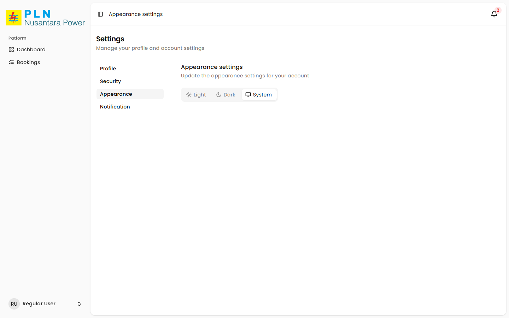

> **Tips keamanan:** Gunakan password yang panjang dan unik, serta jangan membagikannya kepada siapa pun.

---

## 4. Untuk Operator: Meninjau Pengajuan

Tugas utama Anda: memastikan setiap pengajuan layak, lalu **menyetujui** atau **menolaknya** dengan alasan yang jelas.

### Dashboard statistik

Dashboard Operator dan Admin menampilkan grafik 12 bulan terakhir:

- **Acara per Bulan** dan **Acara per Status**
- **Peserta per Bulan** dan **Peserta per Ruangan**
- **User Paling Aktif** dan **Pangsa Pengajuan User**
- **Ruangan Paling Dipakai** dan **Pangsa Pemakaian Ruangan**

Sebagian besar grafik hanya menghitung acara yang sudah **disetujui**.

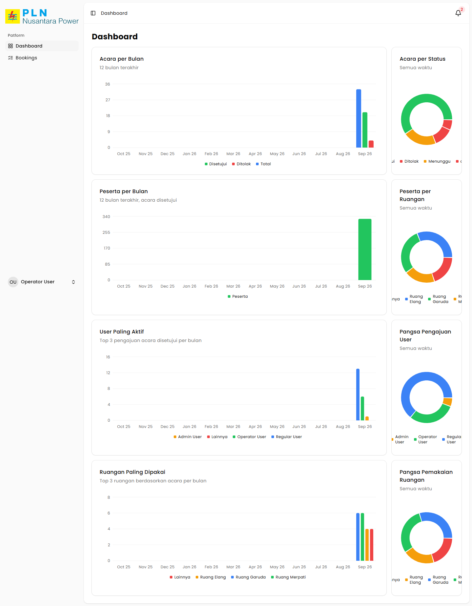

### Meninjau pengajuan

1. Buka **Bookings**, atau klik **Lihat Data** pada dialog **Butuh tindakan** untuk langsung ke daftar Pending.
2. Klik tombol **Pending** untuk menampilkan pengajuan yang menunggu.

   

3. Buka satu pengajuan dengan mengklik judulnya.
4. Periksa **Rincian Pengajuan**. Klik **Dokumen Sumber Acara** dan **QR Attendance** untuk memastikan lampiran benar dan terbaca.
5. Ambil keputusan pada kartu **Actions** di kanan.

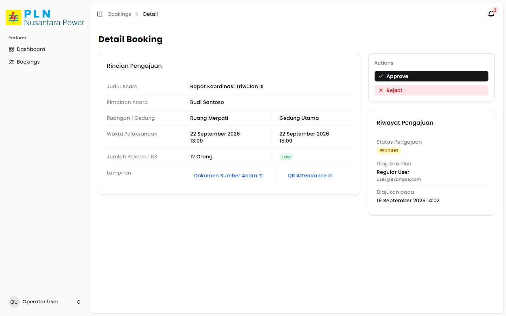

**Checklist singkat sebelum memutuskan:**

- [ ] Dokumen sumber jelas, terbaca, dan sesuai dengan acaranya.
- [ ] QR Attendance dapat dibuka.
- [ ] Ruangan cukup untuk jumlah peserta. Sistem tidak memeriksanya otomatis.
- [ ] Pimpinan acara sesuai dengan dokumen.

### Menyetujui

1. Klik **Approve** pada kartu **Actions**.
2. Dialog **Approve Booking** meminta konfirmasi. Klik **Approve**.

   

3. Muncul pesan *"Booking approved."* Status berubah menjadi **Approved**, pemohon mendapat notifikasi, dan acara tampil di jadwal serta layar display.

   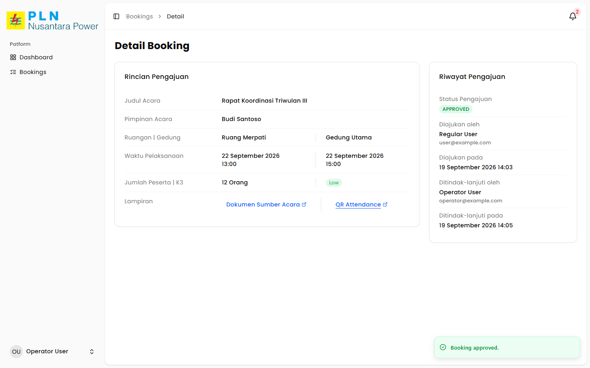

### Menolak

1. Klik **Reject** pada kartu **Actions**.
2. Isi kolom **Reason** (wajib, maksimal 1000 karakter). Tombol **Reject** baru aktif setelah alasan terisi.

   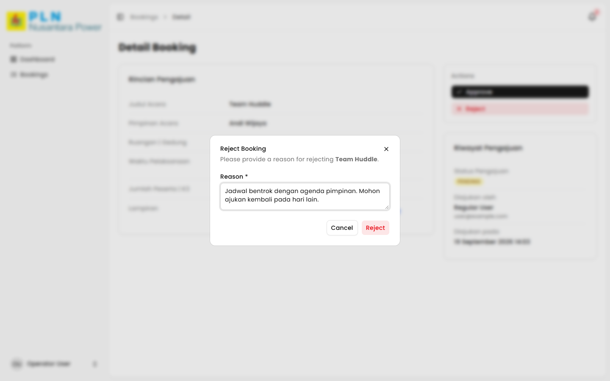

3. Klik **Reject**. Pemohon melihat alasan Anda di kolom **Keterangan** dan mendapat notifikasi.

> **Tips penulisan alasan:** Sebutkan apa yang salah *dan* apa yang perlu diperbaiki. Contoh: *"Dokumen sumber tidak terbaca. Mohon unggah ulang dengan resolusi lebih tinggi."* Alasan yang jelas menghemat satu putaran tanya-jawab.

> **Penting:** Keputusan hanya dapat diambil pada pengajuan berstatus **Pending**. Setelah **Approved** atau **Rejected**, Operator tidak dapat mengubahnya. Jika ada koreksi, minta Admin.

### Notifikasi untuk Operator

Anda menerima notifikasi saat ada booking baru (*"New Booking '…' by …"*) dan saat booking lain disetujui atau ditolak.

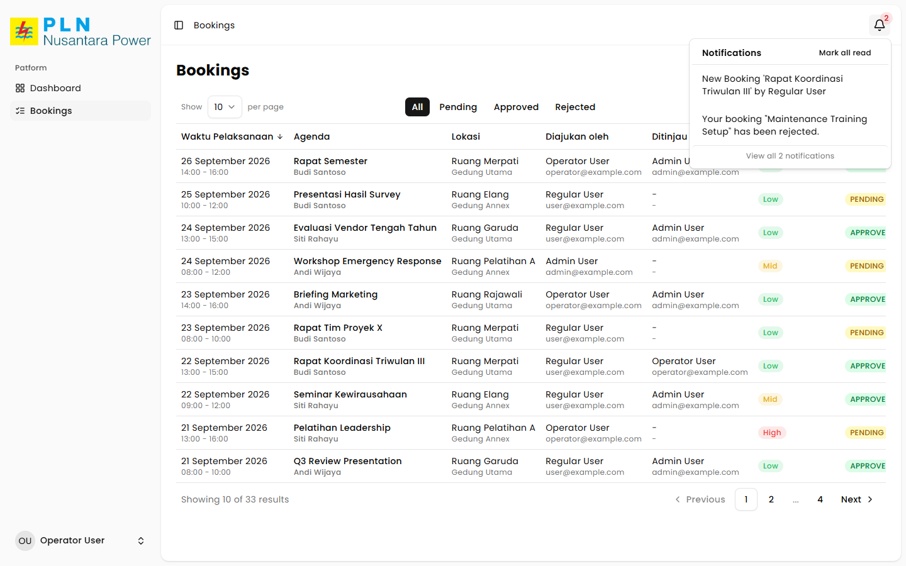

### Catatan untuk Operator

- Operator tidak melihat grup menu **Master**. Pengelolaan data master dilakukan Admin.
- Operator tidak membuat booking. Jika perlu memesan ruangan, gunakan akun Pengguna.

---

## 5. Untuk Admin: Mengelola Data dan Sistem

Admin memiliki seluruh kemampuan Operator, ditambah pengelolaan data master, akun, dan pengaturan sistem lewat grup menu **Master**.

### Mengubah atau menghapus booking

Buka detail booking. Kartu **Actions** untuk Admin memuat tombol **Edit** dan **Delete** (serta **Approve** dan **Reject** jika booking masih Pending).

- **Edit**: membuka dialog **Edit Booking** dengan kolom yang sama seperti saat mengajukan, ditambah **Level Keamanan** yang dapat diatur manual. Lampiran bersifat opsional: unggah hanya jika ingin menggantinya. Klik **Update** untuk menyimpan.

  

- **Delete**: menghapus booking secara permanen setelah konfirmasi di dialog **Delete Booking**. Tindakan ini tidak dapat dibatalkan.

  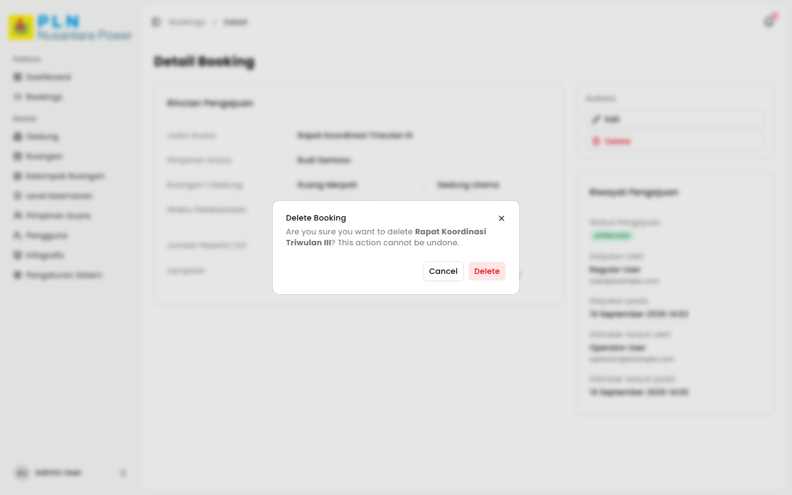

> **Catatan:** Saat mengedit, pengecekan bentrok jadwal tetap berlaku, tetapi batas minimal/maksimal hari pengajuan tidak diterapkan.

### Data master

Semua menu berikut ada di grup **Master**. Polanya seragam: tabel dengan kotak pencarian, tombol tambah di kanan atas, serta ikon pensil (ubah) dan tempat sampah (hapus) di setiap baris.

| Menu | Tombol tambah | Isian | Catatan |
|---|---|---|---|
| **Gedung** | **Tambah Gedung** | **Name**, **Active** | Gedung induk bagi ruangan. |
| **Ruangan** | **Add Room** | **Name**, **Capacity** (min. 1), **Building**, **Active** | Hanya ruangan *Active* yang muncul di formulir booking. Kapasitas hanya sebagai informasi. |
| **Kelompok Ruangan** | **Add Group** | **Building**, **Name**, **Rooms** (pilih beberapa), **Active** | Dipakai untuk layar display lobi, yang menampilkan jadwal beberapa ruangan sekaligus. |
| **Level Keamanan** | **Add Level** | **Name**, **Color**, **Min Participants**, **Max Participants**, **Sort Order**, **Active** | Menentukan level K3 otomatis. Max harus lebih besar atau sama dengan Min. Aplikasi tidak memeriksa rentang yang tumpang tindih atau berlubang, jadi pastikan sendiri rentangnya berurutan dan mencakup seluruh jumlah peserta. |
| **Pimpinan Acara** | **Add Person** | **Name**, **Photo** (gambar, maks. 2 MB), **Active** | Daftar pilihan pada kolom **Pimpinan Acara** di formulir booking. |
| **Pengguna** | **Add User** | **Name**, **Email** (unik), **Password** (min. 8 karakter + konfirmasi), **Role** | Lihat bagian [Mengelola pengguna](#mengelola-pengguna). |

> **Tips:** Menonaktifkan (**Active** dimatikan) lebih aman daripada menghapus. Data lama tetap utuh, tetapi tidak muncul lagi sebagai pilihan.

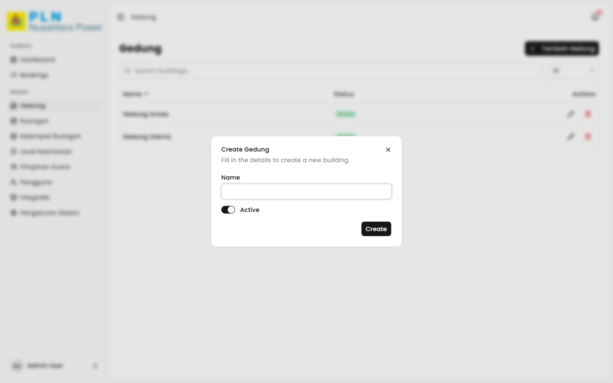

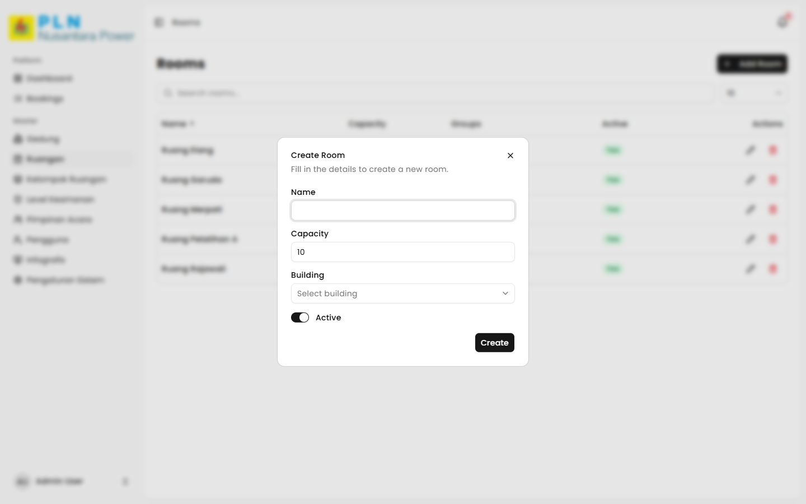

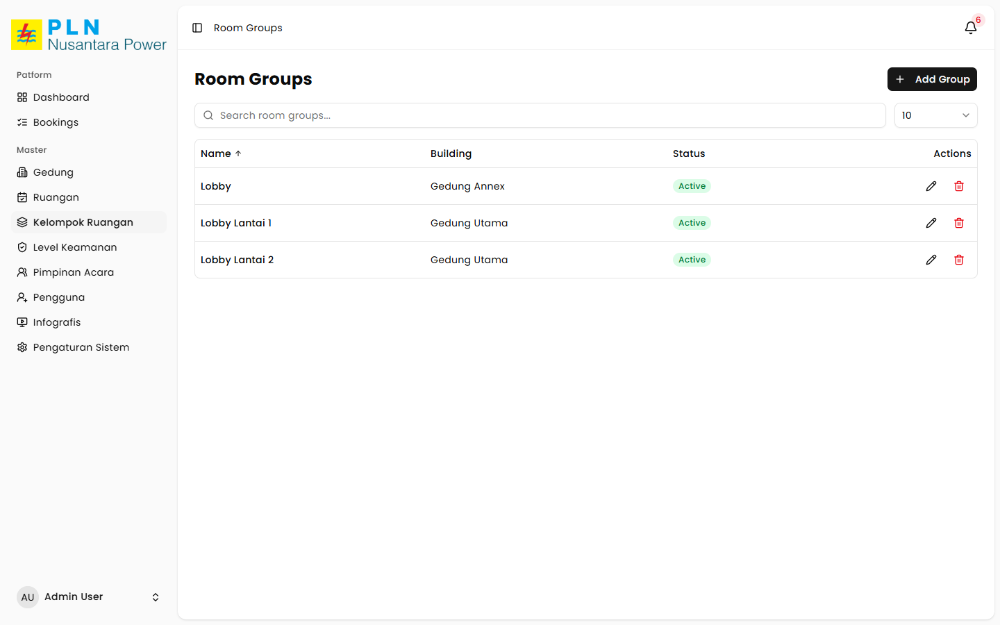

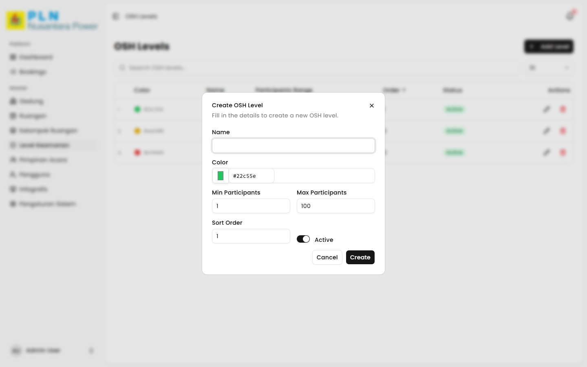

### Mengelola pengguna

1. Buka **Pengguna**, lalu klik **Add User**.
2. Isi **Name**, **Email**, **Password**, dan konfirmasinya.
3. Pilih **Role**:
   - **User**: pemohon booking.
   - **Operator**: peninjau pengajuan.
   - **Admin**: akses penuh.
4. Simpan, lalu sampaikan email dan password sementara kepada pemilik akun. Sarankan mereka menggantinya lewat menu akun → **Security**.

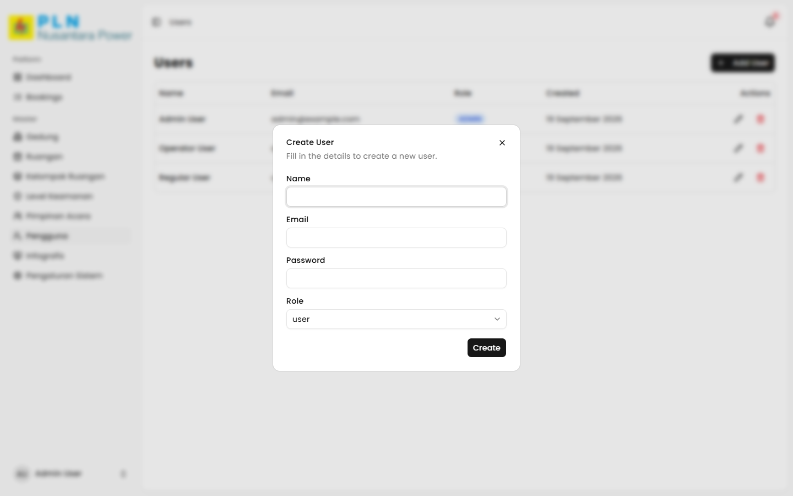

Saat mengubah pengguna, kolom password boleh dikosongkan jika tidak ingin menggantinya. Admin tidak dapat menghapus akunnya sendiri.

> **Lupa password pengguna?** Ubah password mereka di sini, lalu sampaikan password baru secara aman.

### Infografis

Menu **Infografis** mengatur konten yang berputar di layar display.

- **Unggah:** seret dan lepas file ke kotak **Drag & drop or browse**, atau klik **browse**. Format yang didukung: gambar, video (mp4, webm, ogg, mov), dan PDF. Unggahan langsung berjalan begitu file dipilih, dan file besar dikirim bertahap secara otomatis.
- **Atur (di daftar Media List):** pilih beberapa item dengan kotak centang atau **Select all**, aktifkan atau nonaktifkan item dengan saklar, hapus dengan ikon tempat sampah, dan ubah urutan tayang dengan menyeret ikon titik-titik (nomor urut tampil sebagai #1, #2, dst.).

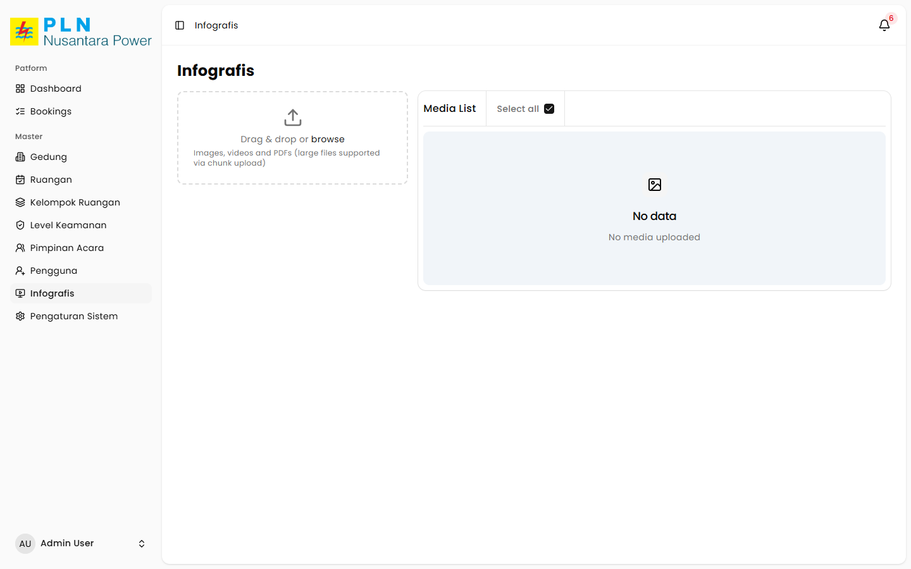

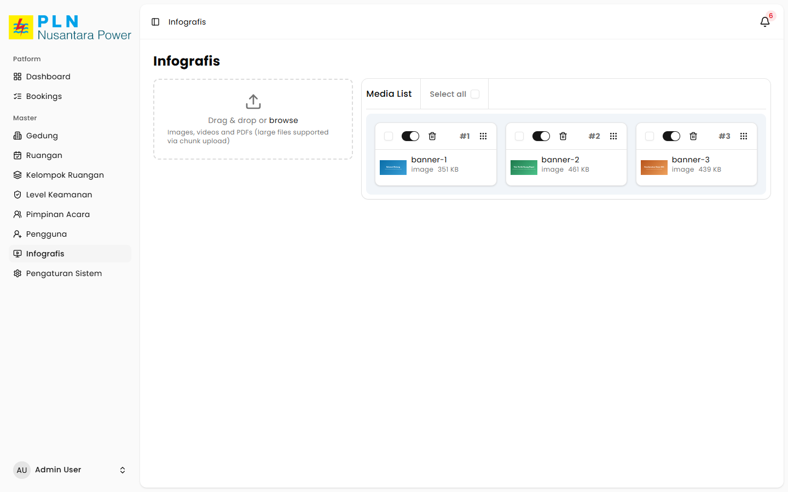

> **Catatan:** Layar display saat ini memutar media dari menu **Infografis** ini. Media yang diunggah khusus per ruangan atau per kelompok ruangan belum ditayangkan di display.

### Pengaturan Sistem

Buka **Pengaturan Sistem**, ubah nilainya, lalu klik **Save**.

| Pengaturan | Fungsinya | Rentang | Bawaan |
|---|---|---|---|
| **Minimal waktu pengajuan** | Berapa jam sebelum acara booking harus diajukan | 0–720 jam | 24 |
| **Maksimal waktu pengajuan** | Berapa hari ke depan booking boleh diajukan | 1–365 hari | 30 |
| **Durasi tampil infografis** | Lama tiap item infografis tampil di layar | 3–120 detik | 10 |
| **Audio Notifikasi** | Suara notifikasi umum sistem (mp3, wav, ogg, m4a, aac, flac; maks. 10 MB) | — | Kosong |

### Monitoring

Buka alamat `/admin/monitoring` di browser (halaman ini tidak ada di menu samping). Halaman **Service Monitoring** menunjukkan kondisi dua layanan penting. Klik **Refresh** untuk memperbarui.

- **Background Worker**: pekerja latar yang mengirim notifikasi. Perhatikan **Jobs Waiting**, **Jobs Failed**, dan **Last Seen**.
- **WebSocket Server**: penghubung pembaruan langsung ke layar display. Perhatikan **Devices Connected**, **Uptime**, dan **Up Since**.

Kondisi sehat, dengan pesan hijau **All services are running**:

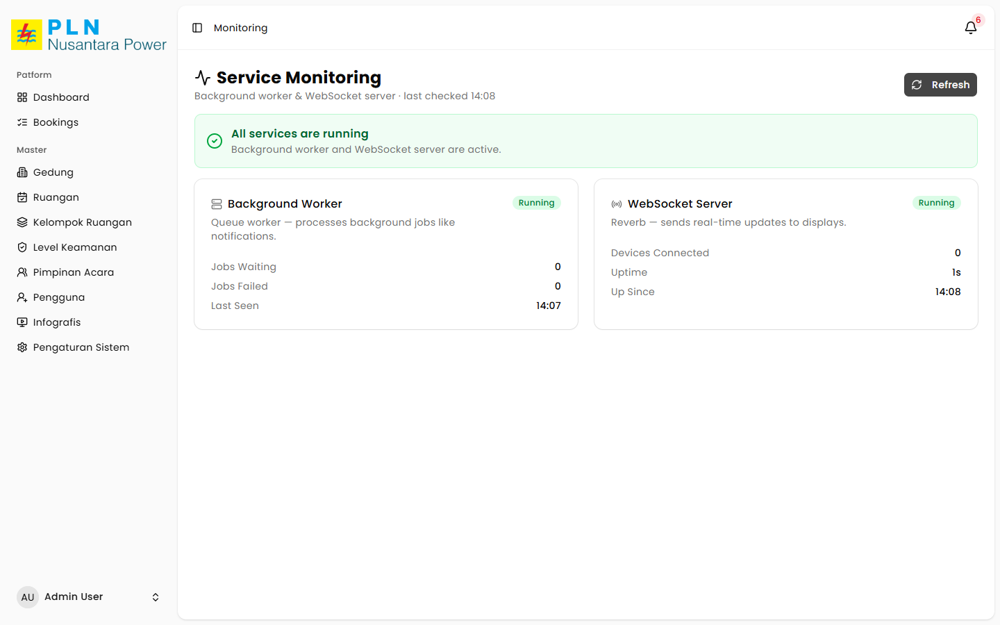

Kondisi bermasalah, dengan peringatan kuning dan status **Stopped**:

> **Kapan mengecek?** Jika notifikasi terlambat atau layar display tidak ikut berubah, mulai dari sini. Angka **Jobs Waiting** yang terus menumpuk, **Last Seen** yang sudah lama, atau status **Stopped** menandakan layanan berhenti. Hubungi tim teknis.

---

## 6. Layar Display (Signage)

Display menampilkan jadwal acara di TV atau monitor, misalnya di lobi dan depan ruang rapat. Halamannya **terbuka tanpa login**, sehingga cocok untuk perangkat kiosk.

### Membuka layar

1. Buka alamat `/display` di browser perangkat display. Halaman **Display Launcher** akan muncul.
2. Pilih layar yang diinginkan:

| Kelompok | Menampilkan |
|---|---|
| **Lobby Displays** | Infografis bergantian dengan kartu acara yang sedang berlangsung di ruangan dalam satu kelompok ruangan |
| **Room Displays** | Acara yang sedang berlangsung dan acara berikutnya di satu ruangan, lengkap dengan QR Attendance |
| **Other Displays → OSH Display** | **Jadwal Hari Ini** dan **Jadwal Besok**, untuk tim keamanan |
| **Other Displays → Infografis Display** | Pemutar infografis layar penuh |

3. Pilih orientasi sesuai layar: **Portrait** (tegak) atau **Landscape** (mendatar).
4. Tekan **F11** agar browser tampil layar penuh.

### Contoh tampilan

**Lobby** menampilkan infografis di satu sisi dan kartu acara **Sedang berlangsung** di sisi lain:

Orientasi **Portrait** menyusun tampilan yang sama secara vertikal:

**Room** menampilkan judul acara, pimpinan, ruangan, jam, dan **QR Attendance** yang Anda unggah saat mengajukan booking:

**OSH Display** menampilkan **Jadwal Hari Ini** dan **Jadwal Besok**, lengkap dengan level keamanan dan jumlah peserta:

**Infografis Display** memutar media yang Admin unggah di menu **Infografis**:

### Yang perlu diketahui

- Hanya acara yang sudah **disetujui** (Approved) yang tampil.
- Status jadwal: **Akan datang**, **Sedang berlangsung**, atau **Sudah selesai**.
- Layar berubah otomatis begitu ada persetujuan atau perubahan baru. Jika koneksi langsung terputus, layar memperbarui diri secara berkala.
- **OSH Display** memutar suara saat ada acara baru. Browser sering memblokir suara, sehingga muncul dialog **Suara belum aktif**. Klik tombol **Aktifkan Suara** sekali agar suara menyala.

  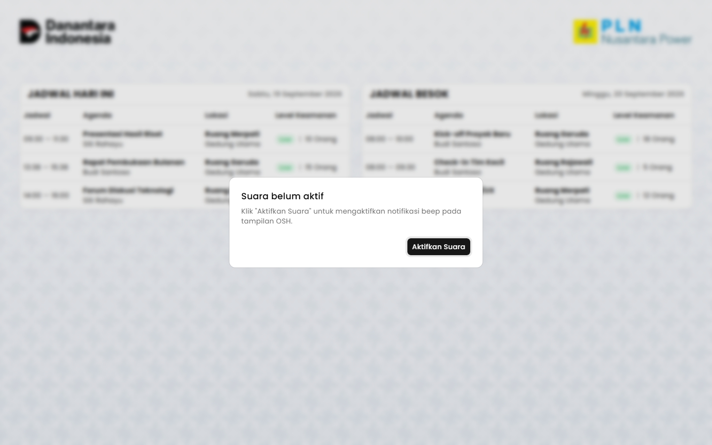

---

## 7. Tanya-Jawab dan Pemecahan Masalah

### Pesan kesalahan saat mengajukan booking

| Pesan yang muncul | Penyebab | Solusi |
|---|---|---|
| *This room is already booked for the selected time slot.* | Ruangan sudah dipesan (Pending atau Approved) pada jam yang beririsan. | Pilih jam lain atau ruangan lain. Cek **Jadwal Acara Kedepan** di Dashboard. |
| *Bookings must be made at least N hour(s) in advance.* | Waktu Mulai terlalu dekat. | Majukan tanggal atau jam acara sesuai batas N jam. |
| *Bookings cannot be made more than N day(s) in advance.* | Waktu Mulai terlalu jauh. | Ajukan lagi mendekati hari acara. |
| Waktu Mulai harus setelah sekarang / Waktu Selesai harus setelah Waktu Mulai | Tanggal atau jam tidak masuk akal. | Periksa tanggal, jam, dan format AM/PM. |
| Lampiran ditolak atau gagal diunggah | Format salah atau ukuran berlebih. | Dokumen: PDF/JPG/PNG maksimal 10 MB. QR: gambar maksimal 5 MB. Kompres file bila perlu. |
| *Failed to create booking.* | Gangguan sementara. | Coba lagi. Jika berulang, hubungi Admin. |

### Pertanyaan umum

**Tombol Book Room tidak muncul.**
Tombol ini hanya tersedia untuk akun berperan Pengguna. Operator dan Admin meninjau dan mengelola booking, tidak membuatnya.

**Nama pimpinan atau ruangan yang saya cari tidak ada di daftar.**
Hanya data berstatus *Active* yang tampil. Minta Admin menambahkan atau mengaktifkannya.

**Bisakah saya membatalkan atau mengubah booking?**
Pengguna tidak dapat mengubah atau membatalkan sendiri. Hubungi Admin dengan menyebutkan judul acaranya.

**Berapa lama pengajuan ditinjau?**
Aplikasi tidak menetapkan batas waktu. Pengajuan tetap **Pending** sampai Operator atau Admin memutuskan. Ajukan sedini mungkin, dan jangan menunggu sampai batas minimal.

**Kenapa acara saya belum muncul di layar display?**
Display hanya menampilkan acara berstatus **Approved**, dan sebagian layar hanya menampilkan jadwal hari ini.

**Saya tidak mendengar suara notifikasi.**
Browser sering memblokir suara sebelum Anda berinteraksi dengan halaman. Klik di halaman sekali, lalu coba **Test Sound** di halaman pengaturan **Notification**. Periksa juga volume perangkat.

**Apakah saya akan menerima email atau WhatsApp?**
Belum. Notifikasi hanya muncul di dalam aplikasi.

**Aplikasi terasa tidak memperbarui data.**
Muat ulang halaman (**F5**). Jika masih bermasalah, hubungi Admin.

---

## 8. Glosarium

| Istilah | Arti |
|---|---|
| **Booking** | Pengajuan pemakaian ruang rapat. |
| **Pimpinan Acara** | Pemimpin atau penanggung jawab acara yang tertera pada booking. |
| **Dokumen Sumber Acara** | Dokumen dasar acara, misalnya surat undangan atau nota dinas. |
| **QR Attendance** | Gambar kode QR yang dipakai peserta untuk absensi acara. Ditampilkan di layar Room pada hari acara. |
| **K3 / OSH** | Keselamatan dan Kesehatan Kerja (*Occupational Safety and Health*). Level Keamanan dipilih otomatis berdasarkan jumlah peserta. |
| **Level Keamanan** | Label berwarna (misalnya Low, Mid, High) sebagai penanda kebutuhan pengamanan acara. |
| **Kelompok Ruangan** | Kumpulan beberapa ruangan dalam satu gedung, dipakai untuk layar display lobi. |
| **Infografis** | Gambar, video, atau PDF yang diputar di layar display. |
| **Display / Signage** | Layar informasi yang menampilkan jadwal acara. |

---

*Butuh bantuan lain? Hubungi Admin aplikasi di unit Anda.*
