# Panduan Pengguna — PLN Meeting Room & Booking Management

Pesan ruang rapat tanpa telepon, tanpa spreadsheet, tanpa jadwal bentrok.

Panduan ini membantu Anda memakai aplikasi dari langkah pertama sampai mahir. Pilih bagian sesuai peran Anda:

| Saya seorang… | Baca bagian |
|---|---|
| **Pengguna** (mengajukan booking ruangan) | [1](#1-mengenal-aplikasi) → [2](#2-memulai) → [3](#3-untuk-pengguna-mengajukan-dan-memantau-booking) → [7](#7-tanya-jawab-dan-pemecahan-masalah) |
| **Operator** (meninjau pengajuan) | [1](#1-mengenal-aplikasi) → [2](#2-memulai) → [4](#4-untuk-operator-meninjau-pengajuan) |
| **Admin** (mengelola sistem) | [1](#1-mengenal-aplikasi) → [2](#2-memulai) → [4](#4-untuk-operator-meninjau-pengajuan) → [5](#5-untuk-admin-mengelola-data-dan-sistem) → [6](#6-layar-display-signage) |

> **Tentang gambar:** Semua tangkapan layar memakai data contoh (nama, email, dan dokumen fiktif). Tampilan di aplikasi Anda akan menyesuaikan data yang ada. Panduan ini menulis nama tombol dan menu persis seperti yang tampil di layar.

---

## 1. Mengenal Aplikasi

### Apa yang bisa Anda lakukan?

- **Mengajukan pemakaian ruang rapat** lengkap dengan tanggal, jam, pimpinan acara, level K3, format acara, dan dokumen pendukung. Ruangan yang sudah terisi terlihat sebelum Anda mengajukan.
- **Memantau status pengajuan** secara langsung: menunggu, disetujui, atau ditolak.
- **Menerima notifikasi** di dalam aplikasi (lengkap dengan suara) begitu ada perkembangan.
- **Melihat jadwal rapat** satu minggu ke depan di menu **Jadwal**, dan rapat mendatang tiap ruangan di menu **Ruang Rapat**.
- **Melihat ruangan mana yang sedang dipakai** lewat kartu **Status Ruangan Saat Ini** di Dashboard.
- **Menampilkan jadwal di layar** lobi, depan ruangan, dan layar informasi lain.

### Peran dan hak akses

Setiap akun punya satu peran. Akun dibuat oleh Admin, jadi Anda tidak perlu mendaftar sendiri.

| Kemampuan | Pengguna | Operator | Admin |
|---|:---:|:---:|:---:|
| Mengajukan booking (**Ajukan Booking**) | ✅ | — | — |
| Melihat booking di menu **Booking** | Milik sendiri | Semua | Semua |
| Melihat **Jadwal**, **Ruang Rapat**, dan **Status Ruangan Saat Ini** | ✅ (semua, hanya baca) | ✅ | ✅ |
| Menyetujui / menolak booking | — | ✅ | ✅ |
| Menandai rapat **selesai** lebih awal | — | ✅ | ✅ |
| Menghapus booking milik sendiri yang **ditolak** | ✅ | — | — |
| Mengubah / menghapus booking siapa pun | — | — | ✅ |
| Melihat statistik di Dashboard dan mengatur tampilannya (**Edit Dashboard**) | — | ✅ | ✅ |
| Mengelola data master (gedung, ruangan, dll.) | — | — | ✅ |
| Mengelola akun pengguna | — | — | ✅ |
| Melihat **Log Aktivitas**, memantau layanan, dan mengatur sistem | — | — | ✅ |
| Notifikasi & pengaturan akun sendiri | ✅ | ✅ | ✅ |

> **Catatan:** Tidak tahu peran Anda? Lihat menu di sisi kiri. Jika grup **Master** muncul, berarti Anda Admin.

### Status booking

| Status | Artinya | Langkah Anda |
|---|---|---|
| 🟡 **Pending** | Pengajuan sudah masuk dan menunggu ditinjau. Jadwalnya sudah *dikunci*, sehingga tidak ada orang lain yang bisa memesan ruangan yang sama di jam itu. | Tunggu notifikasi. |
| 🟢 **Disetujui** | Pengajuan disetujui. Acara muncul di **Jadwal** dan layar display. | Siapkan acara Anda. |
| 🔴 **Ditolak** | Pengajuan tidak disetujui. Alasannya tertulis di kolom **Keterangan** pada halaman detail. | Baca alasannya, lalu ajukan ulang dengan perbaikan. Booking yang ditolak boleh Anda hapus sendiri. |

> Pada data tertentu Anda mungkin juga melihat label abu-abu **Dibatalkan**. Status ini tidak bisa Anda buat sendiri dari aplikasi.

---

## 2. Memulai

### Masuk ke aplikasi

1. Buka alamat aplikasi di browser (Chrome, Edge, atau Firefox versi terbaru).
2. Isi **Alamat email** dan **Kata sandi**.
3. Centang **Ingat saya** jika Anda memakai perangkat pribadi dan ingin tetap masuk.
4. Klik **Masuk**.

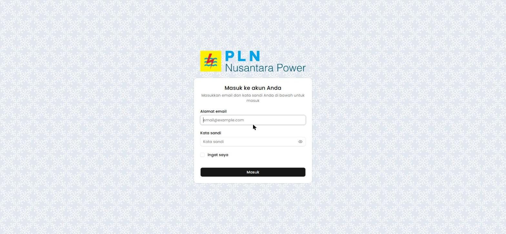

Anda akan langsung diarahkan ke **Dashboard**.

> **Tips:** Setelah beberapa kali salah memasukkan email atau kata sandi, login dikunci sementara (batas 5 kali per menit). Tunggu semenit lalu coba lagi. Setiap login berhasil maupun gagal dicatat Admin di **Log Aktivitas**.

> **Lupa kata sandi?** Aplikasi ini belum menyediakan fitur reset mandiri. Hubungi Admin untuk mendapatkan kata sandi baru, lalu ganti sendiri lewat halaman **Keamanan** di [Pengaturan akun](#pengaturan-akun).

### Khusus Operator dan Admin: pengingat pengajuan

Selama masih ada pengajuan yang menunggu, dialog **Butuh tindakan.** muncul setiap kali Anda membuka atau memuat ulang Dashboard: *"Ada N booking yang belum ditindaklanjuti."*

- Klik **Lihat Data** untuk langsung membuka daftar booking berstatus Pending.
- Klik **Abaikan** untuk menutupnya dan melanjutkan pekerjaan.

### Mengenal tata letak

- **Menu samping (kiri):**
  - Grup **Platform**: **Dashboard**, **Booking**, **Jadwal**, dan **Ruang Rapat**.
  - Grup **Master** (khusus Admin): Gedung, Ruangan, Kelompok Ruangan, Level Keamanan, Pimpinan Acara, Pengguna, Infografis, Log Aktivitas, Pengaturan Sistem.
- **Ikon lonceng (kanan atas):** notifikasi Anda. Angka merah menunjukkan jumlah yang belum dibaca.
- **Menu akun (bagian bawah menu samping):** klik nama Anda untuk membuka **Profil**, **Keamanan**, **Tampilan**, dan **Keluar**.

- **Di HP:** menu samping tersembunyi dan dibuka lewat ikon di pojok kiri atas. Halaman Jadwal, Dashboard, dan formulir booking menyesuaikan lebar layar HP.

### Keluar dari aplikasi

Buka menu akun di bagian bawah menu samping, lalu klik **Keluar**. Selalu keluar jika Anda memakai komputer bersama.

---

## 3. Untuk Pengguna: Mengajukan dan Memantau Booking

### Membaca Dashboard

**Dashboard** adalah halaman pertama Anda. Isinya:

- **Total Booking**: seluruh pengajuan Anda.
- **Pending**: yang menunggu ditinjau.
- **Disetujui**: yang sudah disetujui.
- **Ditolak**: yang tidak disetujui.
- **Status Ruangan Saat Ini**: kartu tiap ruangan. **Hijau** berarti *Tersedia*, **gelap/merah** berarti *Terpakai*. Klik kartu ruangan yang terpakai untuk membuka detail rapatnya. Rapat milik pengguna lain hanya bisa dilihat, tidak diubah.
- **Jadwal Acara Kedepan**: semua acara *disetujui* yang sedang dan akan berlangsung (tidak hanya milik Anda). Gunakan kotak **Cari agenda atau ruangan...** untuk mencari.

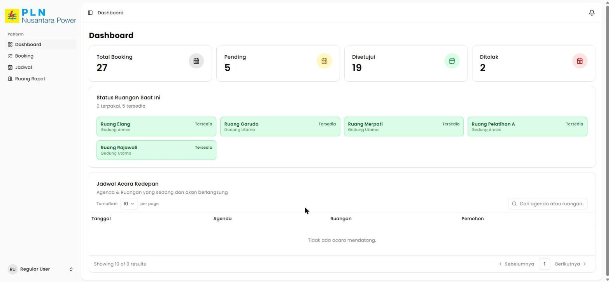

> **Tips:** Sebelum mengajukan, cek dulu **Status Ruangan Saat Ini** dan menu **Jadwal**. Itu cara cepat melihat ruangan mana yang sudah terisi.

### Melihat jadwal dan ruangan sebelum mengajukan

**Jadwal** menampilkan kalender tujuh hari mulai hari ini, satu kolom per hari. Setiap kartu berisi jam (merah), judul acara, ruangan dan gedung, serta label pimpinan berwarna.

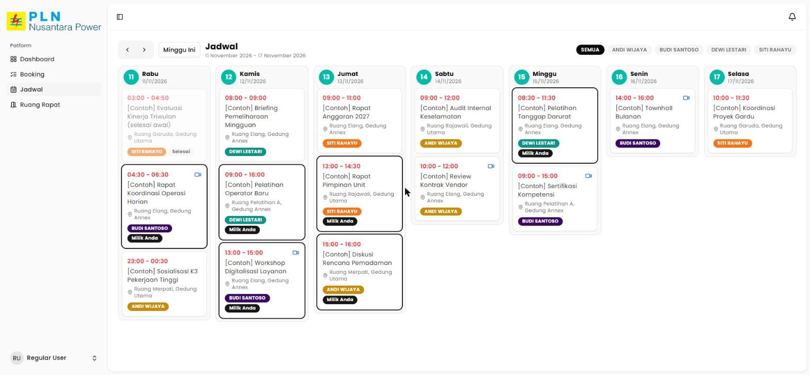

- Klik kartu untuk membuka halaman detail booking.
- Tombol **‹** dan **›** menggeser satu minggu, **Minggu Ini** kembali ke hari ini.
- Deretan label pimpinan di kanan atas menyaring jadwal per pimpinan. **SEMUA** menampilkan semuanya lagi.
- Kartu bergaris tebal dengan label **Milik Anda** adalah booking Anda. Kartu lain hanya bisa dilihat. Ikon kamera berarti acara **Hybrid (Zoom)**, dan label **Selesai** berarti rapat sudah ditandai selesai.

**Ruang Rapat** menampilkan semua ruangan beserta kapasitasnya dan rapat yang akan datang di ruangan itu (hari, jam, judul, pimpinan, jumlah peserta). Klik **Selengkapnya** untuk melihat semua rapat ruangan tersebut.

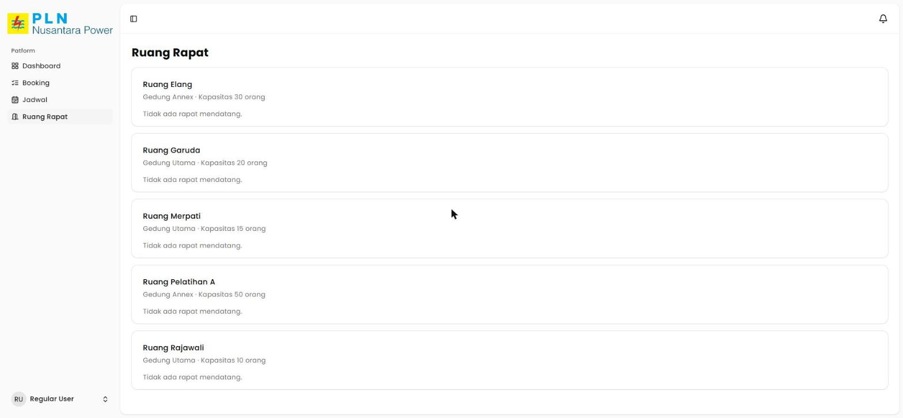

### Mengajukan booking ruangan

**Siapkan dulu (agar sekali jalan):**

- Judul acara dan jumlah peserta.
- Nama pimpinan acara dan **level K3** acara.
- **Dokumen sumber acara**, misalnya surat undangan atau nota dinas. Format PDF, JPG, atau PNG, maksimal **10 MB**.
- **Gambar QR Attendance** untuk absensi peserta. Format gambar, maksimal **5 MB**.

**Langkah-langkah:**

1. Buka menu **Booking**.
2. Klik **Ajukan Booking** (pojok kanan atas). Formulir akan terbuka.

   

3. Isi seluruh kolom, lihat tabel di bawah.

   

4. Pilih **Ruangan** lebih dulu, lalu **Tanggal**, **Jam Mulai**, dan **Jam Selesai** (lihat [Memilih ruangan dan jam](#memilih-ruangan-dan-jam)).
5. Klik **Ajukan**.
6. Bila berhasil, muncul pesan *"Booking berhasil diajukan."* dan pengajuan Anda tampil di daftar dengan status **Pending**.

> Tombol **Ajukan Booking** hanya muncul untuk akun berperan Pengguna.

**Isi formulir:**

| Kolom | Wajib | Cara mengisi |
|---|:---:|---|
| **Judul Acara** | ✅ | Nama acara, maksimal 200 karakter. Buat spesifik, misalnya *"Rapat Koordinasi Triwulan III"*. |
| **Pimpinan Acara** | ✅ | Klik kolom, lalu ketik atau pilih nama dari daftar. Jika nama tidak ada, minta Admin menambahkannya di menu **Pimpinan Acara**. |
| **Ruangan** | ✅ | Pilih ruangan. Kapasitas tampil di samping nama, misalnya *"Ruang Garuda (kapasitas: 20)"*. |
| **Tanggal**, **Jam Mulai**, **Jam Selesai** | ✅ | Pilih tanggal dari kalender, lalu jam. Hanya tanggal dan jam yang masih kosong yang bisa dipilih. |
| **Jumlah Peserta** | ✅ | Minimal 1. |
| **Level K3** | ✅ | Pilih level keamanan acara dari daftar. **Anda yang menentukan**, tidak lagi otomatis dari jumlah peserta, karena tidak semua acara mengikuti jumlah peserta. |
| **Format Acara** | — | **Offline** (bawaan) atau **Hybrid (Zoom)**. Hybrid hanya penanda: acara tampil dengan ikon Zoom di Dashboard, Jadwal, dan layar TV. Link Zoom tidak diisi di sini. |
| **Keterangan** | — | Teks bebas (maksimal 1000 karakter) untuk permintaan atau informasi khusus, misalnya kebutuhan peralatan. Muncul di halaman detail booking. |
| **Lampiran Dokumen Sumber** | ✅ | PDF / JPG / PNG, maksimal 10 MB. Di bawah kolom ini ada tautan pintas ke aplikasi dokumen. Klik untuk membukanya di tab baru. |
| **Lampiran QR Attendance** | ✅ | File gambar, maksimal 5 MB. QR ini ditampilkan di layar depan ruangan pada hari acara agar peserta dapat memindainya. Di bawah kolom ini ada tautan pintas ke aplikasi kehadiran (tab baru). |

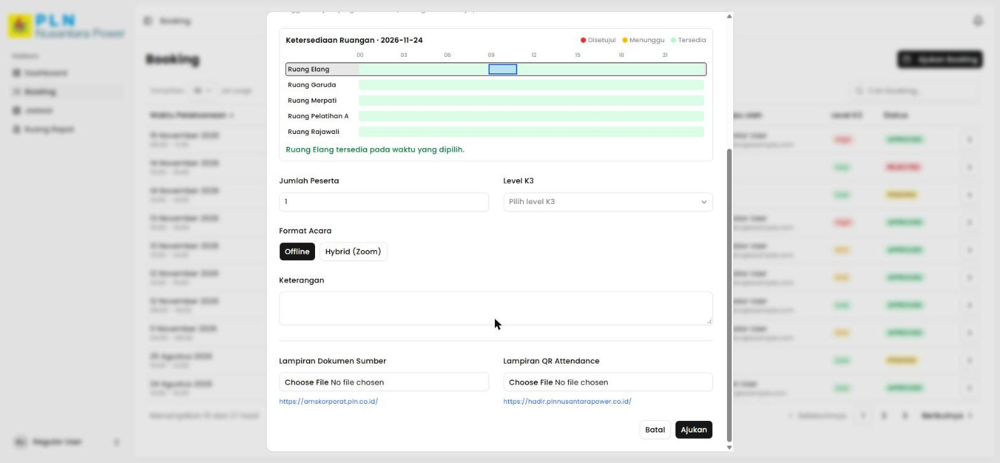

> **Penting:** Aplikasi menampilkan kapasitas ruangan tetapi **tidak memblokir** jika jumlah peserta melebihi kapasitas. Pastikan sendiri ruangan cukup.

#### Memilih ruangan dan jam

Formulir menampilkan ketersediaan **sebelum** Anda mengajukan, seperti memilih kursi pada tiket bus atau pesawat:

1. Pilih **Ruangan**. Kolom **Tanggal** baru bisa dipakai setelah ruangan dipilih.
2. Klik **Tanggal**. Pada kalender, tanggal yang **sebagian terisi** diberi penanda, dan tanggal yang **sudah penuh** atau di luar batas pengajuan berwarna abu-abu dan tidak bisa dipilih.

   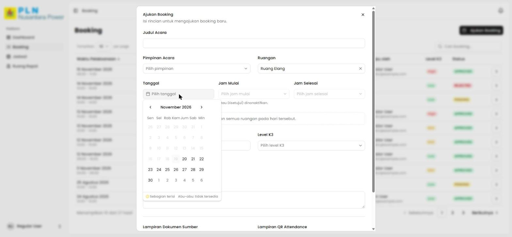

3. Pilih **Jam Mulai** dan **Jam Selesai**. Jam yang sudah terisi booking **Pending** atau **Disetujui** dinonaktifkan.
4. Setelah tanggal dipilih, panel **Ketersediaan Ruangan** muncul. Panel ini menunjukkan semua ruangan dalam satu hari: **merah** = disetujui, **kuning** = menunggu, **hijau muda** = tersedia, dan kotak **biru** = jam yang Anda pilih. Klik nama ruangan di panel untuk berpindah ruangan.
5. Di bawah panel, aplikasi menulis hasilnya: *"… tersedia pada waktu yang dipilih"*, atau memperingatkan jika bentrok. Tombol **Ajukan** nonaktif selama waktu Anda bentrok.

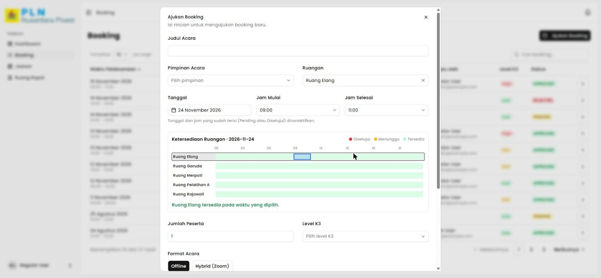

**Aturan waktu yang perlu Anda tahu:**

| Aturan | Nilai bawaan | Keterangan |
|---|---|---|
| Ajukan minimal sebelum acara | **24 jam** | Waktu Mulai harus sedikitnya 24 jam dari sekarang. |
| Ajukan paling jauh | **30 hari** ke depan | Acara lebih jauh dari itu belum bisa diajukan. |
| Ruangan tidak boleh bentrok | — | Dicek terhadap booking **Pending** dan **Disetujui** di ruangan yang sama. Booking **Ditolak** tidak menghalangi. |
| Batas kirim | 10 kali per menit | Cukup longgar untuk pemakaian normal. |

> **Tips:** Angka 24 jam dan 30 hari dapat diubah Admin. Jika pesan error menyebut angka lain, itulah aturan yang berlaku saat ini.

**Kalau muncul pesan error**, pesannya tampil merah di bawah kolom yang bermasalah dan sebagai notifikasi di pojok kanan bawah. Perbaiki kolom tersebut, lalu klik **Ajukan** lagi. Isian lain Anda tidak hilang.

### Memantau pengajuan Anda

Buka **Booking** untuk melihat semua pengajuan Anda.

**Menyaring dan mencari:**

- Tombol **Semua**, **Pending**, **Disetujui**, **Ditolak** menyaring berdasarkan status.
- Kotak **Cari booking...** mencari berdasarkan judul acara atau nama ruangan.
- Klik judul kolom **Waktu Pelaksanaan** atau **Status** untuk mengurutkan.
- Pilih jumlah baris per halaman di **Tampilkan** (10, 25, 50, atau 100).

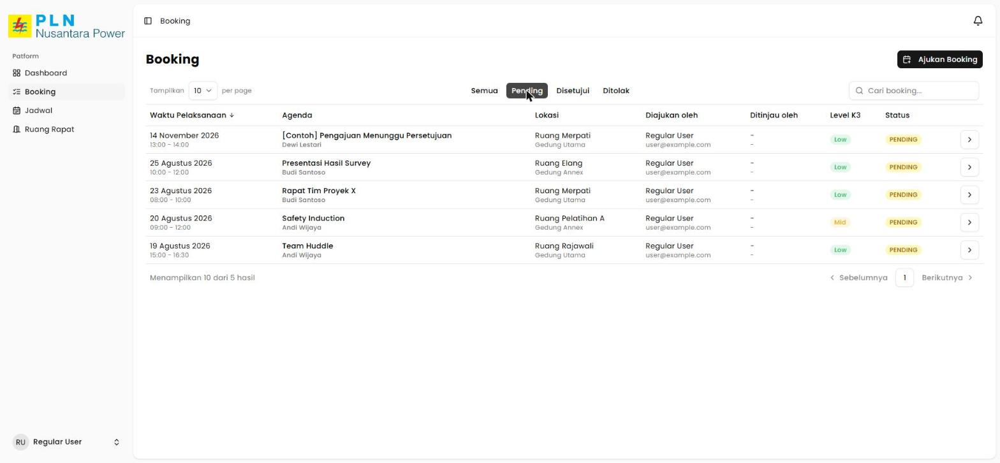

**Kolom yang tersedia:**

| Kolom | Isinya |
|---|---|
| **Waktu Pelaksanaan** | Tanggal dan jam acara |
| **Agenda** | Judul acara dan nama pimpinan |
| **Lokasi** | Ruangan dan gedung |
| **Diajukan oleh** | Nama dan email pemohon |
| **Ditinjau oleh** | Operator/Admin yang menindaklanjuti (`-` jika belum) |
| **Level K3** | Label level K3 |
| **Status** | Pending / Disetujui / Ditolak |

### Melihat detail dan alasan penolakan

Klik judul acara, atau tombol panah (**›**) di ujung baris, untuk membuka **Detail Booking**.

- **Rincian Pengajuan**: judul, pimpinan, ruangan dan gedung, waktu pelaksanaan, jumlah peserta dan level K3, **Format Acara**, **Keterangan**, serta lampiran.
- **Lampiran**: klik **Dokumen Sumber Acara** atau **QR Attendance** untuk melihat pratinjaunya (**Pratinjau File**) tanpa meninggalkan halaman. Pratinjau berfungsi untuk PDF, JPG, dan PNG.
- **Riwayat Pengajuan**: status terkini, siapa yang mengajukan dan kapan, siapa yang menindaklanjuti dan kapan. Jika rapat ditandai selesai lebih awal, waktu **Selesai Aktual** juga tampil.
- **Keterangan** pada **Riwayat Pengajuan**: muncul jika pengajuan **ditolak**, berisi alasan dari peninjau.

Setelah pengajuan disetujui, halaman detail memperlihatkan siapa yang menindaklanjuti dan kapan. Untuk booking milik orang lain, halaman hanya menampilkan pesan *"Jadwal milik pengguna lain. Anda hanya dapat melihatnya."*

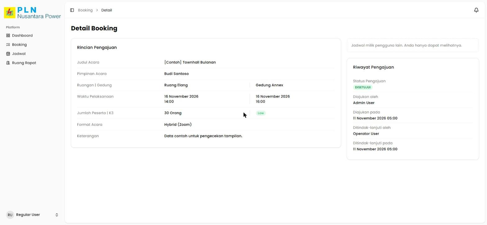

### Kalau pengajuan ditolak atau perlu diubah

- **Ditolak:** Anda akan mendapat **popup dan suara** begitu pengajuan ditolak (saat Anda sedang memakai aplikasi, atau saat pertama kali masuk). Baca alasan di **Keterangan**, perbaiki (misalnya ganti jam, ruangan, atau dokumen), lalu ajukan ulang lewat **Ajukan Booking**.

  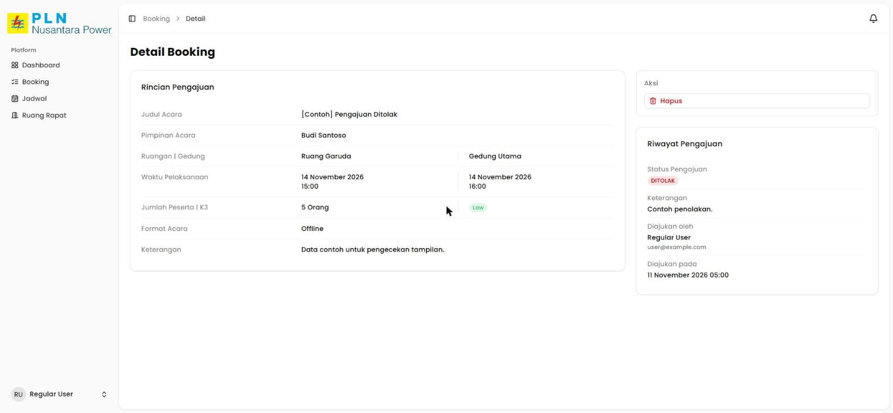

- **Menghapus pengajuan yang ditolak:** di halaman detailnya klik **Hapus** pada kartu **Aksi**, lalu konfirmasi di dialog **Hapus Booking**. Hanya pemilik yang bisa menghapus, dan hanya untuk booking berstatus **Ditolak**. Tindakan ini tidak dapat dibatalkan.
- **Perlu diubah setelah diajukan:** Pengguna tidak dapat mengubah atau membatalkan booking sendiri. Hubungi Admin untuk perubahan, dan sebutkan judul acaranya.

### Notifikasi

Anda mendapat notifikasi di dalam aplikasi (tanpa email atau WhatsApp) ketika pengajuan Anda **disetujui** atau **ditolak**, lengkap dengan nama peninjau.

- Klik **ikon lonceng** untuk melihat notifikasi terbaru. Klik **Lihat semua notifikasi** untuk membuka daftar lengkap.
- Di halaman **Notifikasi**, **Tandai semua dibaca** menandai semuanya sudah dibaca dan **Bersihkan semua** membersihkan daftar. Setiap notifikasi juga punya ikon tempat sampah (hapus).
- Jika tab aplikasi sedang tidak Anda lihat, judul tab berkedip saat ada notifikasi baru. Bila perangkat sempat tidur atau jaringan terputus, notifikasi yang terlewat tampil begitu Anda kembali.
- **Suara notifikasi bisa diblokir browser.** Jika muncul tombol oranye **Klik untuk mengaktifkan suara notifikasi** di pojok kanan bawah, klik sekali agar suara menyala. Browser mewajibkan satu klik Anda sebelum boleh memutar suara.

### Pengaturan akun

Buka menu akun di bagian bawah menu samping, lalu klik **Profil**, **Keamanan**, atau **Tampilan**. Halaman **Pengaturan** punya empat bagian di sisi kirinya:

| Halaman | Fungsinya |
|---|---|
| **Profil** | Ubah **Nama** dan **Alamat email**, lalu klik **Simpan**. |
| **Keamanan** | Ganti kata sandi: isi **Kata sandi saat ini**, **Kata sandi baru**, dan **Konfirmasi kata sandi**, lalu klik **Simpan**. |
| **Tampilan** | Pilih tema: **Terang**, **Gelap**, atau **Sistem** (mengikuti perangkat). |
| **Notifikasi** | Pilih suara notifikasi pribadi di **Audio Notifikasi**. Unggah file audio (mp3, wav, ogg, m4a, aac, flac; maksimal 10 MB), coba dengan **Tes Suara**, lalu klik **Simpan**. Kosongkan untuk memakai audio bawaan. |

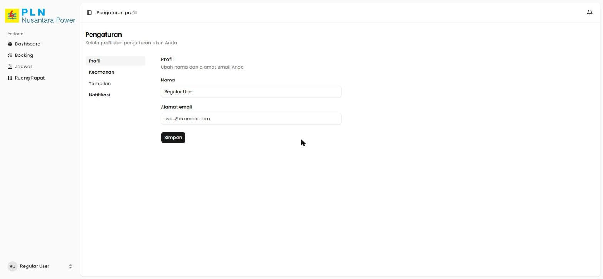

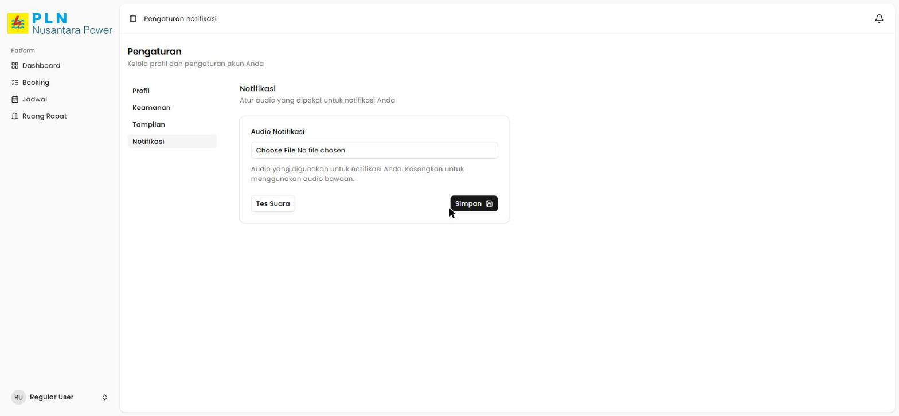

> **Tips keamanan:** Gunakan kata sandi yang panjang dan unik, serta jangan membagikannya kepada siapa pun.

---

## 4. Untuk Operator: Meninjau Pengajuan

Tugas utama Anda: memastikan setiap pengajuan layak, lalu **menyetujui** atau **menolaknya** dengan alasan yang jelas.

### Dashboard statistik

Dashboard Operator dan Admin menampilkan **Status Ruangan Saat Ini** dan grafik 12 bulan terakhir:

- **Acara per Bulan** dan **Acara per Status**
- **Peserta per Bulan** dan **Peserta per Ruangan**
- **User Paling Aktif** dan **Pangsa Pengajuan User**
- **Ruangan Paling Dipakai** dan **Pangsa Pemakaian Ruangan**

Sebagian besar grafik hanya menghitung acara yang sudah **disetujui**.

### Mengatur tampilan Dashboard

Dashboard terasa terlalu ramai? Klik **Edit Dashboard** (kanan atas), lalu:

- **Geser** blok (tarik ikon titik-titik di kiri judul blok) untuk mengubah urutannya.
- Klik **Sembunyikan** pada blok yang tidak Anda perlukan. Blok yang disembunyikan tampil redup bertanda *(disembunyikan)*; klik **Tampilkan** untuk memunculkannya lagi.
- Klik **Simpan** untuk menerapkan, atau **Batal** untuk membuang perubahan.

Pengaturan ini **hanya berlaku untuk akun Anda**, sehingga tidak mengubah tampilan Operator atau Admin lain.

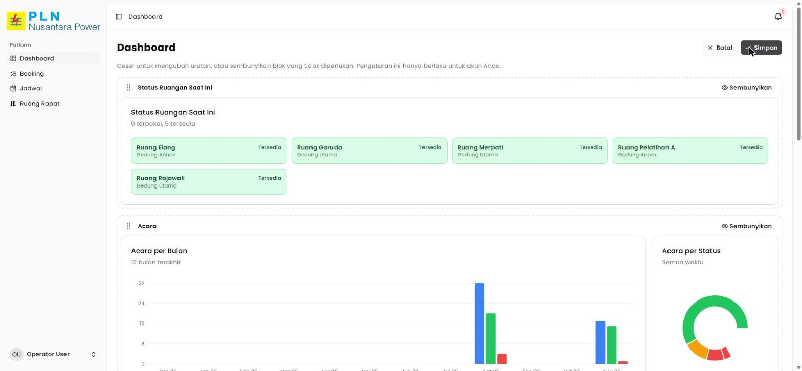

### Meninjau pengajuan

1. Buka **Booking**, atau klik **Lihat Data** pada dialog **Butuh tindakan** untuk langsung ke daftar Pending.
2. Klik tombol **Pending** untuk menampilkan pengajuan yang menunggu.

   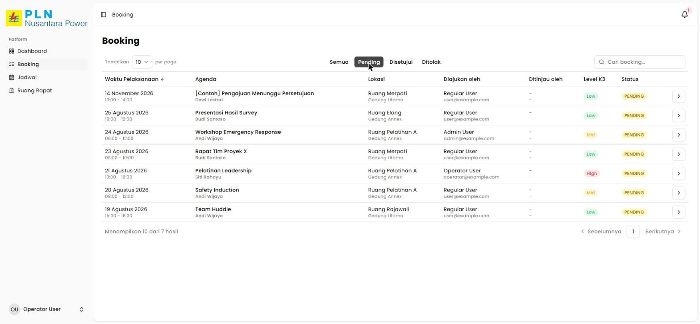

3. Buka satu pengajuan dengan mengklik judulnya.
4. Periksa **Rincian Pengajuan**. Klik **Dokumen Sumber Acara** dan **QR Attendance** untuk memastikan lampiran benar dan terbaca.
5. Ambil keputusan pada kartu **Aksi** di kanan.

**Checklist singkat sebelum memutuskan:**

- [ ] Dokumen sumber jelas, terbaca, dan sesuai dengan acaranya.
- [ ] QR Attendance dapat dibuka.
- [ ] Ruangan cukup untuk jumlah peserta. Sistem tidak memeriksanya otomatis.
- [ ] Pimpinan acara dan level K3 sesuai dengan dokumen.

### Menyetujui

1. Klik **Setujui** pada kartu **Aksi**.
2. Dialog **Setujui Booking** meminta konfirmasi. Klik **Setujui**.

   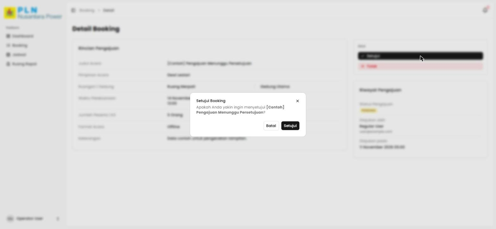

3. Muncul pesan *"Booking disetujui."* Status berubah menjadi **Disetujui**, pemohon mendapat notifikasi, dan acara tampil di **Jadwal** serta layar display.

### Menolak

1. Klik **Tolak** pada kartu **Aksi**.
2. Isi kolom **Alasan** (wajib, maksimal 1000 karakter). Tombol **Tolak** baru aktif setelah alasan terisi.

   

3. Klik **Tolak**. Pemohon melihat alasan Anda di kolom **Keterangan**, mendapat notifikasi, dan mendengar suara pemberitahuan.

> **Tips penulisan alasan:** Sebutkan apa yang salah *dan* apa yang perlu diperbaiki. Contoh: *"Dokumen sumber tidak terbaca. Mohon unggah ulang dengan resolusi lebih tinggi."* Alasan yang jelas menghemat satu putaran tanya-jawab.

> **Penting:** Keputusan hanya dapat diambil pada pengajuan berstatus **Pending**. Setelah **Disetujui** atau **Ditolak**, Operator tidak dapat mengubahnya. Jika ada koreksi, minta Admin.

### Menandai rapat selesai lebih awal

Jika rapat selesai sebelum jam yang dijadwalkan, buka detail booking-nya, lalu klik **Rapat Selesai** pada kartu **Aksi** dan konfirmasi. Tombol ini hanya muncul untuk rapat yang **sedang berlangsung**.

- Ruangan langsung **tersedia** untuk booking lain, dan kartu di **Status Ruangan Saat Ini** kembali hijau.
- Di **Jadwal** dan layar display, rapat tampil dengan label **Selesai** / **Sudah selesai**.
- Waktu **Selesai Aktual** tercatat di **Riwayat Pengajuan**.

### Melihat jadwal dan ketersediaan ruangan

Menu **Jadwal** dan **Ruang Rapat** (lihat [bagian Pengguna](#melihat-jadwal-dan-ruangan-sebelum-mengajukan)) juga tersedia untuk Operator. Gunakan **Status Ruangan Saat Ini** di Dashboard untuk melihat ruangan mana yang kosong saat ini.

### Notifikasi untuk Operator

Anda menerima notifikasi saat ada booking baru dan saat booking lain disetujui atau ditolak. Notifikasi bersuara; jika browser memblokir suara, klik tombol **Klik untuk mengaktifkan suara notifikasi** sekali.

### Catatan untuk Operator

- Operator tidak melihat grup menu **Master**. Pengelolaan data master dilakukan Admin.
- Operator tidak membuat booking. Jika perlu memesan ruangan, gunakan akun Pengguna.

---

## 5. Untuk Admin: Mengelola Data dan Sistem

Admin memiliki seluruh kemampuan Operator, ditambah pengelolaan data master, akun, log, dan pengaturan sistem lewat grup menu **Master**.

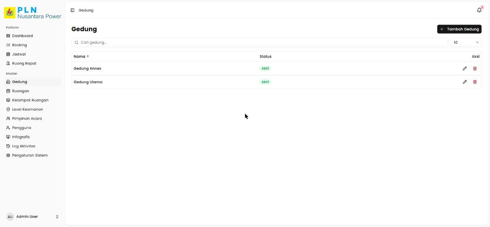

### Mengubah atau menghapus booking

Buka detail booking. Kartu **Aksi** untuk Admin memuat tombol **Ubah** dan **Hapus** (serta **Setujui** dan **Tolak** jika booking masih Pending).

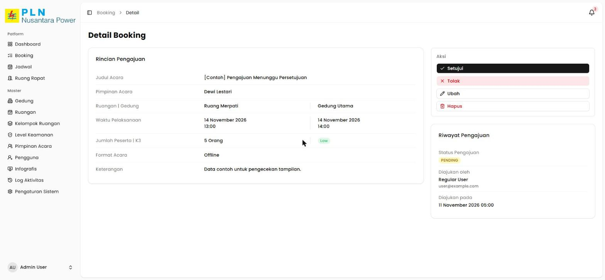

- **Ubah**: membuka dialog **Ubah Booking** dengan kolom yang sama seperti saat mengajukan, termasuk panel ketersediaan. Lampiran bersifat opsional: unggah hanya jika ingin menggantinya. Klik **Perbarui** untuk menyimpan.

  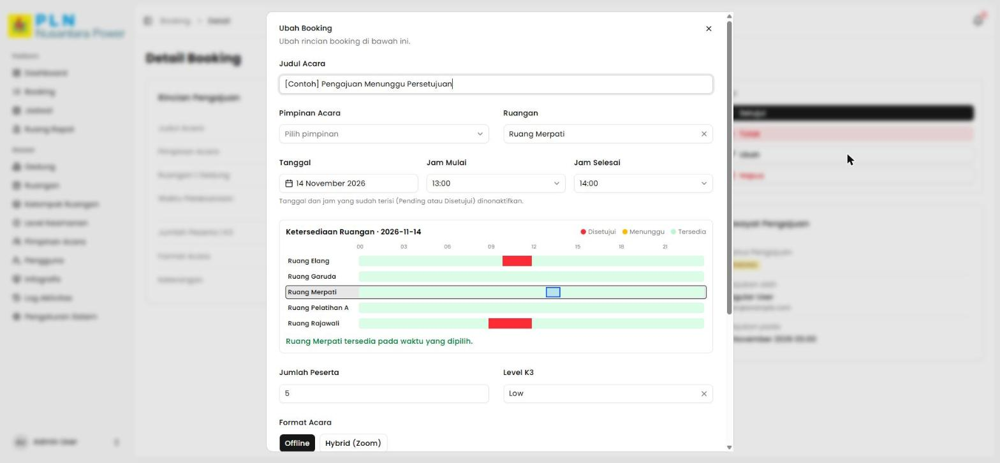

- **Hapus**: menghapus booking secara permanen setelah konfirmasi di dialog **Hapus Booking**. Tindakan ini tidak dapat dibatalkan.

> **Catatan:** Saat mengubah, pengecekan bentrok jadwal tetap berlaku, tetapi batas minimal/maksimal hari pengajuan tidak diterapkan.

### Data master

Semua menu berikut ada di grup **Master**. Polanya seragam: tabel dengan kotak pencarian, tombol **Tambah …** di kanan atas, serta ikon pensil (ubah) dan tempat sampah (hapus) di setiap baris.

| Menu | Tombol tambah | Isian | Catatan |
|---|---|---|---|
| **Gedung** | **Tambah Gedung** | **Nama**, **Aktif** | Gedung induk bagi ruangan. |
| **Ruangan** | **Tambah Ruangan** | **Nama**, **Kapasitas** (min. 1), **Gedung**, **Aktif** | Hanya ruangan *Aktif* yang muncul di formulir booking. Kapasitas hanya sebagai informasi. |
| **Kelompok Ruangan** | **Tambah Kelompok** | **Gedung**, **Nama**, **Ruangan** (pilih beberapa), **Aktif** | Dipakai untuk layar display lobi, yang menampilkan jadwal beberapa ruangan sekaligus. |
| **Level Keamanan** | **Tambah Level** | **Nama**, **Warna**, rentang peserta (minimum dan maksimum), **Urutan**, **Aktif** | Daftar pilihan pada kolom **Level K3** di formulir booking. Rentang peserta hanya informasi, karena pengguna memilih level secara manual. |
| **Pimpinan Acara** | **Tambah Pimpinan** | **Nama**, **Foto** (gambar, maks. 2 MB), **Aktif** | Daftar pilihan pada kolom **Pimpinan Acara** di formulir booking dan penyaring di **Jadwal**. |
| **Pengguna** | **Tambah Pengguna** | **Nama**, **Email** (unik), **Kata sandi** (min. 8 karakter + konfirmasi), **Peran** | Lihat bagian [Mengelola pengguna](#mengelola-pengguna). |

> **Tips:** Menonaktifkan (**Aktif** dimatikan) lebih aman daripada menghapus. Data lama tetap utuh, tetapi tidak muncul lagi sebagai pilihan.

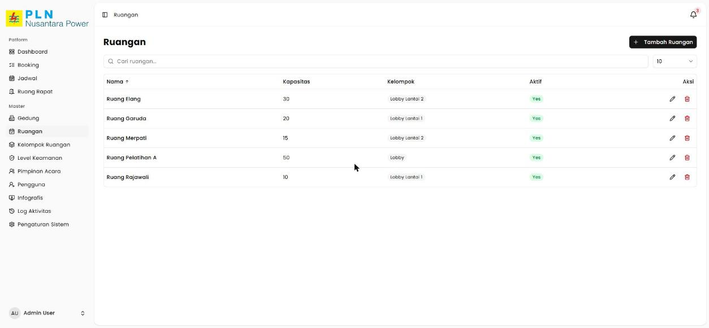

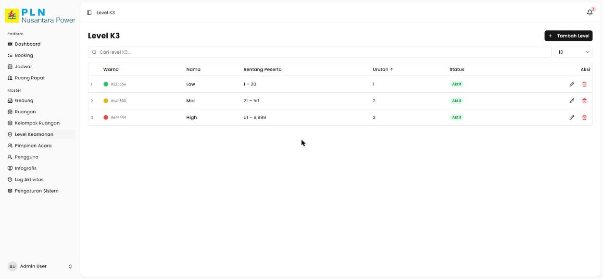

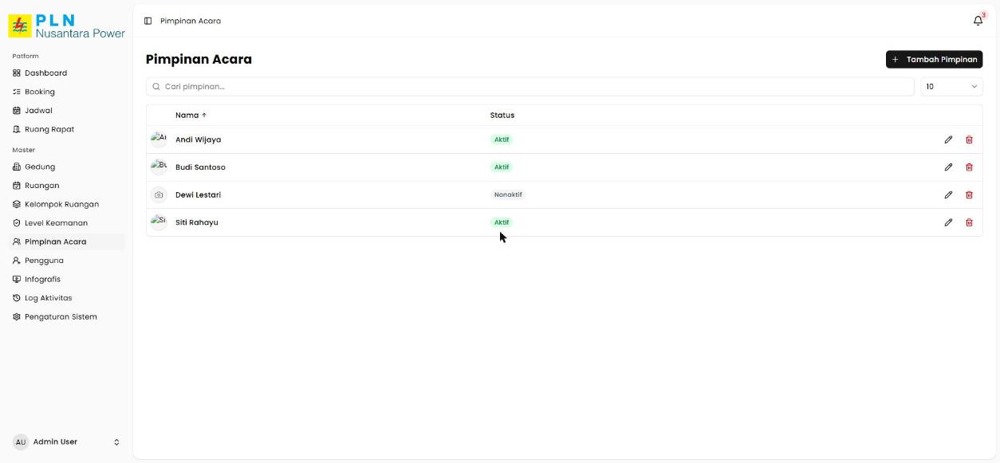

### Mengelola pengguna

1. Buka **Pengguna**, lalu klik **Tambah Pengguna**.
2. Isi **Nama**, **Email**, **Kata sandi**, dan konfirmasinya.
3. Pilih **Peran**:
   - **User**: pemohon booking.
   - **Operator**: peninjau pengajuan.
   - **Admin**: akses penuh.
4. Simpan, lalu sampaikan email dan kata sandi sementara kepada pemilik akun. Sarankan mereka menggantinya lewat menu akun → **Keamanan**.

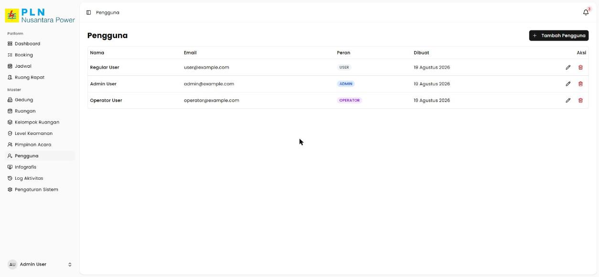

Saat mengubah pengguna, kolom kata sandi boleh dikosongkan jika tidak ingin menggantinya. Admin tidak dapat menghapus akunnya sendiri.

> **Lupa kata sandi pengguna?** Ubah kata sandi mereka di sini, lalu sampaikan kata sandi baru secara aman.

### Infografis

Menu **Infografis** mengatur konten yang berputar di layar display.

- **Unggah:** seret dan lepas file ke kotak unggah, atau klik **telusuri**. Format yang didukung: gambar, video (mp4, webm, ogg, mov), dan PDF. Unggahan langsung berjalan begitu file dipilih, dan file besar dikirim bertahap secara otomatis.
- **PDF diubah menjadi gambar.** Saat Anda mengunggah PDF, browser Anda langsung mengubah tiap halaman menjadi gambar sebelum dikirim, supaya tampil di TV Samsung (Tizen). **Tunggu sampai bilah kemajuan selesai dan jangan menutup halaman** selama proses ini. PDF tetap tayang per halaman dengan durasi yang sama seperti gambar. Bila konversi gagal, muncul peringatan dan PDF tetap tersimpan serta ditayangkan seadanya.
- **PDF lama** (diunggah sebelum fitur ini ada) tetap tayang seperti biasa, tetapi di sebagian TV mungkin tampil putih. Unggah ulang PDF-nya agar menjadi gambar.
- **Atur (di daftar Daftar Media):** pilih beberapa item dengan kotak centang atau **Pilih semua**, aktifkan atau nonaktifkan item dengan saklar, hapus dengan ikon tempat sampah, dan ubah urutan tayang dengan menyeret ikon titik-titik (nomor urut tampil sebagai #1, #2, dst.).
- Ukuran tiap file tercatat dan tampil di daftar.

> **Catatan:** Layar display saat ini memutar media dari menu **Infografis** ini. Media yang diunggah khusus per ruangan atau per kelompok ruangan belum ditayangkan di display.

### Pengaturan Sistem

Buka **Pengaturan Sistem**, ubah nilainya, lalu klik **Simpan**.

| Pengaturan | Fungsinya | Rentang | Bawaan |
|---|---|---|---|
| **Minimal waktu pengajuan** | Berapa jam sebelum acara booking harus diajukan | 0–720 jam | 24 |
| **Maksimal waktu pengajuan** | Berapa hari ke depan booking boleh diajukan | 1–365 hari | 30 |
| **Durasi tampil infografis** | Lama tiap item infografis (dan tiap halaman PDF) tampil di layar | 3–120 detik | 10 |
| **Audio Notifikasi** | Suara notifikasi umum sistem (mp3, wav, ogg, m4a, aac, flac; maks. 10 MB) | — | Kosong |

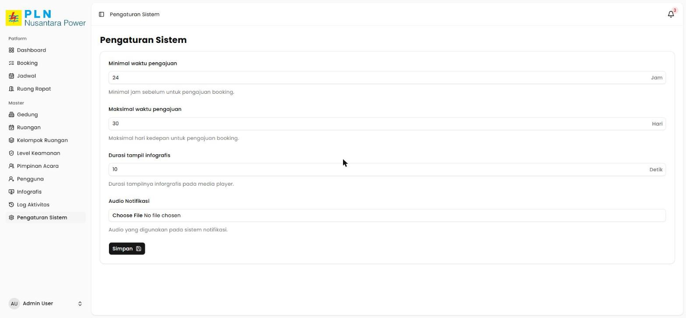

### Log Aktivitas

Menu **Log Aktivitas** membantu Admin memantau keamanan: siapa melakukan apa, dari IP mana. Log disimpan 180 hari.

- **Ringkasan:** **User Online**, **Aktivitas Hari Ini**, **Login Hari Ini**, dan **Login Gagal (24 jam)**.
- **User Online:** daftar akun yang aktif dalam 5 menit terakhir, lengkap dengan peran, alamat **IP**, perangkat, dan waktu aktif terakhir.
- **Riwayat Aktivitas:** tabel waktu, pengguna, aktivitas, IP, dan perangkat. Saring dengan tombol **Semua**, **Login**, **Login Gagal**, **Booking**, **Data Master**, **Pengguna**, atau **Sistem**, atau cari lewat kotak pencarian (nama, email, IP, atau aktivitas).
- Yang dicatat: login berhasil, **percobaan login gagal**, logout, pengajuan/persetujuan/penolakan booking, perubahan data master dan pengguna, serta tindakan di halaman monitoring.

> **Tips:** Banyak **Login Gagal** dari satu IP, atau akun yang tampil online dari IP yang tidak dikenal, adalah tanda untuk segera mengganti kata sandi akun terkait dan memakai **Keluarkan Semua Pengguna** (lihat Monitoring).

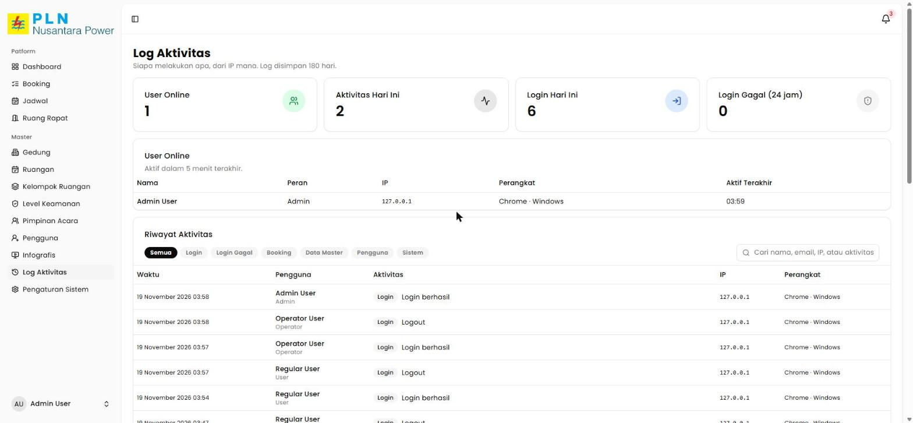

### Pemantauan Layanan

Buka alamat `/admin/monitoring` di browser (halaman ini tidak ada di menu samping). Halaman **Pemantauan Layanan** menunjukkan kondisi server dan menyediakan tombol tindakan cepat. Klik **Muat ulang** untuk memperbarui.

- **Pekerja Latar Belakang**: pekerja yang mengirim notifikasi. Perhatikan **Tugas Menunggu**, **Tugas Gagal**, dan **Terakhir Aktif**.
- **Server WebSocket**: penghubung pembaruan langsung ke layar display. Perhatikan **Perangkat Terhubung**, **Waktu Aktif**, dan **Aktif Sejak**.
- **Kendali Layanan**: tombol **Jalankan** (atau **Restart** jika layanan sedang berjalan) untuk tiap layanan. Dipakai bila status **Berhenti**.
- **Kesehatan Server**: ringkasan database, ruang disk, folder penyimpanan, cache, ukuran berkas log, dan peringatan jika mode debug masih aktif.
- **Tindakan Cepat** (khusus Admin, semuanya dicatat di Log Aktivitas):
  - **Bersihkan Cache**: menghapus cache konfigurasi, rute, dan tampilan. Berguna jika halaman terasa aneh atau lambat. Layanan latar belakang tidak terganggu.
  - **Keluarkan Semua Pengguna**: memutus semua sesi login selain sesi Anda. Gunakan saat ada indikasi akun disalahgunakan.
  - **Export Database**: mengunduh cadangan seluruh data (berkas `.sql`). Berisi data pengguna, simpan di tempat aman.

Kondisi bermasalah, dengan peringatan kuning dan status **Berhenti** (di sini kedua layanan belum dijalankan):

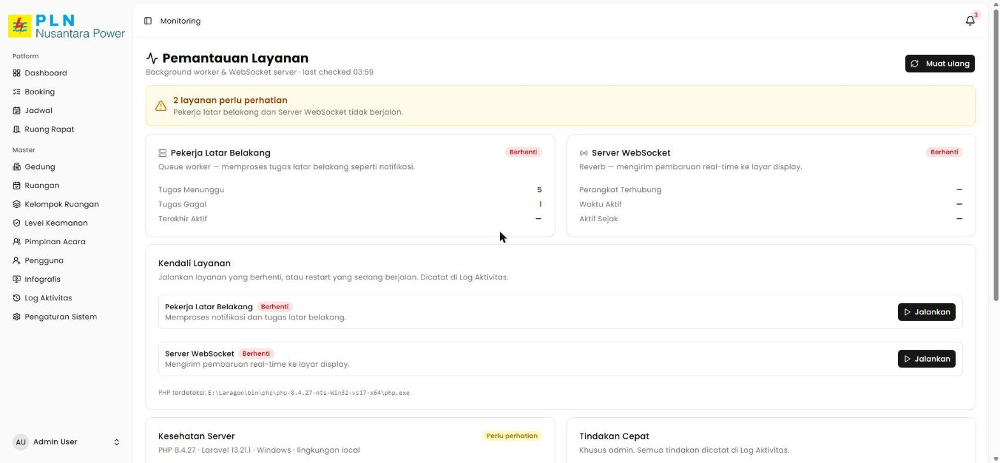

Bagian bawah halaman: **Kendali Layanan**, **Kesehatan Server**, dan **Tindakan Cepat**:

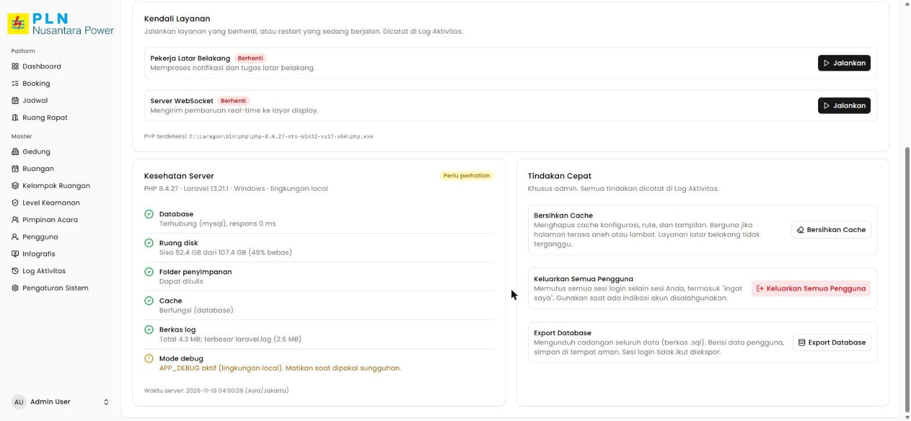

> **Kapan mengecek?** Jika notifikasi terlambat atau layar display tidak ikut berubah, mulai dari sini. **Tugas Menunggu** yang terus menumpuk, **Terakhir Aktif** yang sudah lama, atau status **Berhenti** menandakan layanan mati. Coba **Jalankan**; bila tetap bermasalah, hubungi tim teknis. Untuk menyalakan layanan otomatis setelah PC server dihidupkan ulang, lihat [AUTO-START.md](AUTO-START.md).

---

## 6. Layar Display (Signage)

Display menampilkan jadwal acara di TV atau monitor, misalnya di lobi dan depan ruang rapat. Halamannya **terbuka tanpa login**, sehingga cocok untuk perangkat kiosk.

### Membuka layar

1. Buka alamat `/display` di browser perangkat display. Halaman **Peluncur Display** akan muncul.
2. Pilih layar yang diinginkan:

| Kelompok | Menampilkan |
|---|---|
| **Display Lobi** | Infografis bergantian dengan kartu acara di ruangan dalam satu kelompok ruangan. Rapat yang sudah selesai tetap tampil dengan label **Sudah selesai**. |
| **Display Ruangan** | Acara yang sedang berlangsung dan acara berikutnya di satu ruangan, lengkap dengan QR Attendance. Setelah rapat selesai, layar kembali memutar infografis. |
| **Display Lainnya → Display K3** | **Jadwal Hari Ini** dan **Jadwal Besok**, untuk tim keamanan (K3). |
| **Display Lainnya → Display Infografis** | Pemutar infografis layar penuh. |

3. Pilih orientasi sesuai layar: **Portrait** (tegak) atau **Landscape** (mendatar).
4. Tekan **F11** agar browser tampil layar penuh.

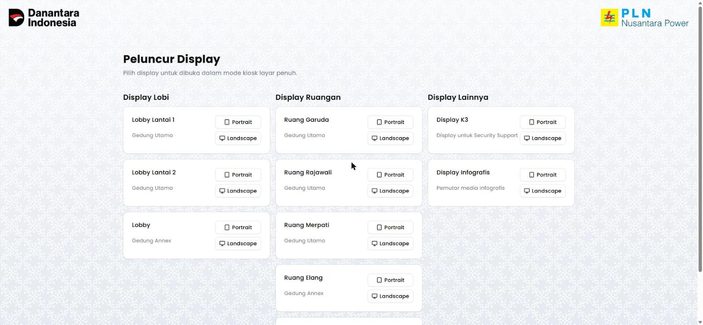

### Contoh tampilan

**Lobi** menampilkan infografis di satu sisi dan kartu acara di sisi lain:

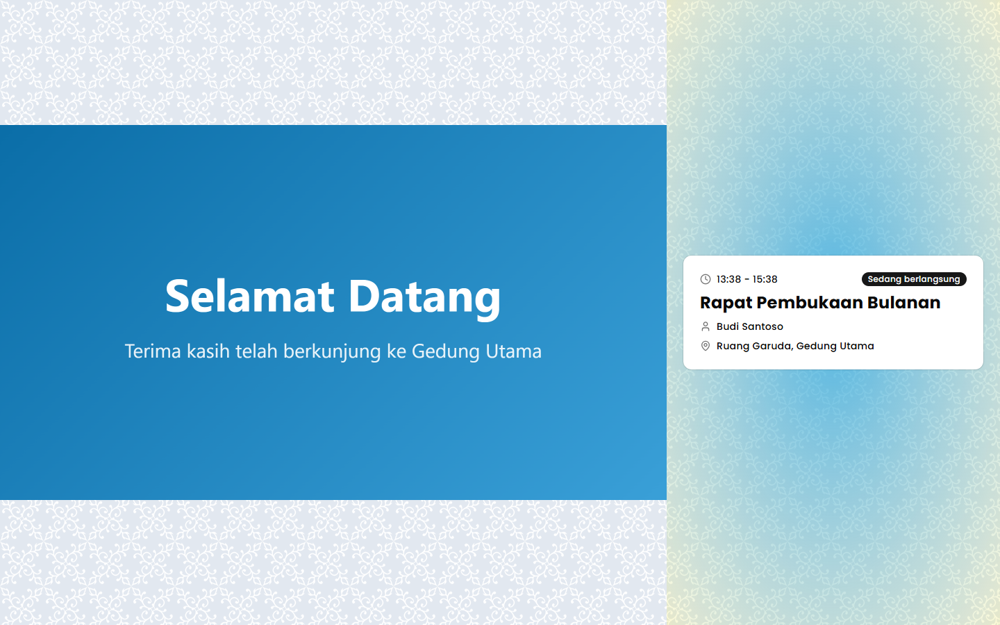

Orientasi **Portrait** menyusun tampilan yang sama secara vertikal:

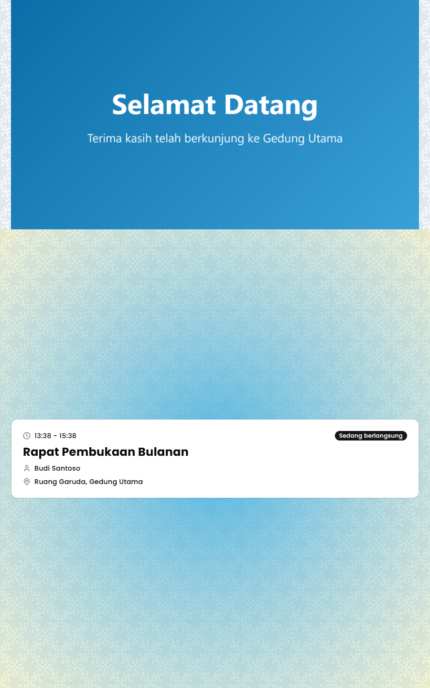

**Ruangan** menampilkan judul acara, pimpinan, ruangan, jam, dan **QR Attendance** yang Anda unggah saat mengajukan booking:

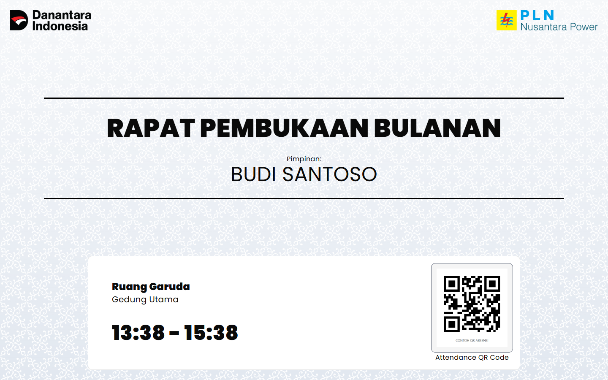

**Display K3** menampilkan **Jadwal Hari Ini** dan **Jadwal Besok**, lengkap dengan level K3 dan jumlah peserta:

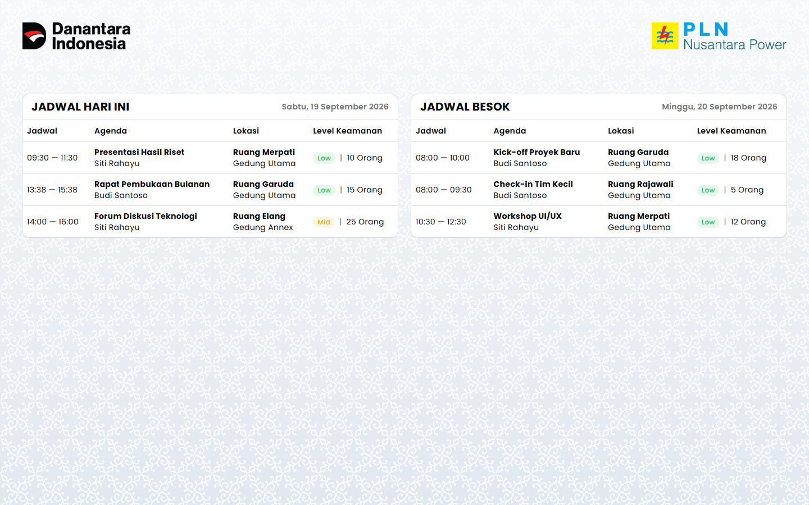

**Display Infografis** memutar media yang Admin unggah di menu **Infografis**:

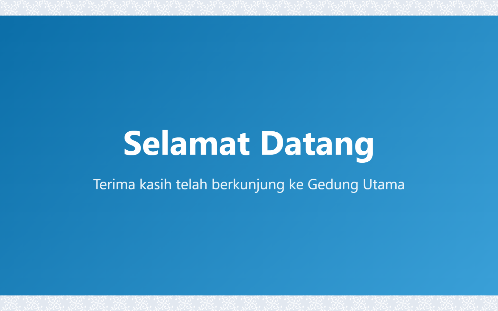

### Yang perlu diketahui

- Hanya acara yang sudah **disetujui** yang tampil.
- Status jadwal: **Akan datang**, **Sedang berlangsung**, atau **Sudah selesai**. Rapat yang ditandai selesai lebih awal langsung berstatus **Sudah selesai**.
- Acara berformat **Hybrid (Zoom)** diberi ikon kamera pada layar.
- Layar berubah otomatis begitu ada persetujuan atau perubahan baru. Jika koneksi langsung terputus, layar memperbarui diri secara berkala.
- **Pemulihan otomatis:** halaman display memuat ulang dirinya sendiri tiap 6 jam, dan setelah TV bangun dari standby atau jaringan kembali. Tidak perlu memuat ulang manual.
- **Display K3** memutar suara saat ada acara baru. Browser sering memblokir suara, sehingga muncul dialog **Suara belum aktif**. Klik tombol **Aktifkan Suara** sekali agar suara menyala.

  

- Untuk PC layar K3 yang harus berbunyi tanpa klik sama sekali, tim teknis dapat menjalankan browser dengan opsi `--autoplay-policy=no-user-gesture-required`.

---

## 7. Tanya-Jawab dan Pemecahan Masalah

### Pesan kesalahan saat mengajukan booking

| Pesan yang muncul | Penyebab | Solusi |
|---|---|---|
| *Ruangan sudah dipesan pada waktu yang dipilih.* | Ruangan sudah dipesan (Pending atau Disetujui) pada jam yang beririsan. | Pilih jam lain atau ruangan lain. Lihat panel **Ketersediaan Ruangan** di formulir atau menu **Jadwal**. |
| *Booking harus diajukan minimal N jam sebelumnya.* | Waktu Mulai terlalu dekat. | Majukan tanggal atau jam acara sesuai batas N jam. |
| *Booking tidak dapat diajukan lebih dari N hari ke depan.* | Waktu Mulai terlalu jauh. | Ajukan lagi mendekati hari acara. |
| Waktu Mulai harus setelah sekarang / Waktu Selesai harus setelah Waktu Mulai | Tanggal atau jam tidak masuk akal. | Periksa tanggal dan jam yang dipilih. |
| Lampiran ditolak atau gagal diunggah | Format salah atau ukuran berlebih. | Dokumen: PDF/JPG/PNG maksimal 10 MB. QR: gambar maksimal 5 MB. Kompres file bila perlu. |
| *Gagal mengajukan booking.* | Gangguan sementara. | Coba lagi. Jika berulang, hubungi Admin. |

### Pertanyaan umum

**Tombol Ajukan Booking tidak muncul.**
Tombol ini hanya tersedia untuk akun berperan Pengguna. Operator dan Admin meninjau dan mengelola booking, tidak membuatnya.

**Tanggal atau jam yang saya mau berwarna abu-abu / tidak bisa dipilih.**
Waktu itu sudah terisi booking lain (Pending atau Disetujui) di ruangan yang dipilih, atau di luar batas pengajuan. Pilih waktu lain atau klik ruangan lain di panel **Ketersediaan Ruangan**.

**Kolom Tanggal tidak bisa diklik.**
Pilih **Ruangan** terlebih dulu. Ketersediaan dihitung per ruangan.

**Bagaimana menandai acara sebagai hybrid?**
Pilih **Hybrid (Zoom)** pada **Format Acara**. Ini hanya penanda (ikon Zoom di Dashboard, Jadwal, dan layar). Link Zoom tidak disimpan di aplikasi.

**Nama pimpinan atau ruangan yang saya cari tidak ada di daftar.**
Hanya data berstatus *Aktif* yang tampil. Minta Admin menambahkan atau mengaktifkannya.

**Bisakah saya membatalkan atau mengubah booking?**
Pengguna tidak dapat mengubah atau membatalkan sendiri. Hubungi Admin dengan menyebutkan judul acaranya. Satu-satunya yang bisa Anda lakukan sendiri adalah **menghapus** booking milik Anda yang berstatus **Ditolak**.

**Berapa lama pengajuan ditinjau?**
Aplikasi tidak menetapkan batas waktu. Pengajuan tetap **Pending** sampai Operator atau Admin memutuskan. Ajukan sedini mungkin, dan jangan menunggu sampai batas minimal.

**Kenapa acara saya belum muncul di Jadwal atau layar display?**
Jadwal dan display hanya menampilkan acara berstatus **Disetujui**, dan sebagian layar hanya menampilkan jadwal hari ini.

**Saya tidak mendengar suara notifikasi.**
Browser sering memblokir suara sebelum Anda berinteraksi dengan halaman. Klik tombol **Klik untuk mengaktifkan suara notifikasi** bila muncul, atau klik di halaman sekali, lalu coba **Tes Suara** di halaman pengaturan **Notifikasi**. Periksa juga volume perangkat.

**Apakah saya akan menerima email atau WhatsApp?**
Belum. Notifikasi hanya muncul di dalam aplikasi.

**Aplikasi terasa tidak memperbarui data.**
Muat ulang halaman (**F5**). Jika masih bermasalah, hubungi Admin.

**Layar TV putih atau tidak berubah.**
Layar display memuat ulang dirinya sendiri secara berkala dan saat TV bangun dari standby. Jika tetap putih, muat ulang halaman sekali (tombol refresh browser atau **F5**), lalu hubungi tim teknis dan cek **Pemantauan Layanan**.

---

## 8. Glosarium

| Istilah | Arti |
|---|---|
| **Booking** | Pengajuan pemakaian ruang rapat. |
| **Pimpinan Acara** | Pemimpin atau penanggung jawab acara yang tertera pada booking. |
| **Dokumen Sumber Acara** | Dokumen dasar acara, misalnya surat undangan atau nota dinas. |
| **QR Attendance** | Gambar kode QR yang dipakai peserta untuk absensi acara. Ditampilkan di layar Ruangan pada hari acara. |
| **K3 / OSH** | Keselamatan dan Kesehatan Kerja (*Occupational Safety and Health*). **Level K3** dipilih manual oleh pengaju saat booking. |
| **Level Keamanan** | Label berwarna (misalnya Low, Mid, High) sebagai penanda kebutuhan pengamanan acara. Daftarnya diatur Admin. |
| **Format Acara** | **Offline** atau **Hybrid (Zoom)**. Hybrid hanya penanda dan ditampilkan dengan ikon Zoom. |
| **Kelompok Ruangan** | Kumpulan beberapa ruangan dalam satu gedung, dipakai untuk layar display lobi. |
| **Infografis** | Gambar, video, atau PDF yang diputar di layar display. PDF dipecah menjadi gambar per halaman saat diunggah. |
| **Display / Signage** | Layar informasi yang menampilkan jadwal acara. |
| **Rapat Selesai** | Tombol Operator/Admin untuk menutup rapat yang sedang berlangsung lebih awal, sehingga ruangan langsung tersedia. |
| **Log Aktivitas** | Catatan login, percobaan login gagal, dan aksi pengguna yang hanya bisa dilihat Admin. |

---

*Butuh bantuan lain? Hubungi Admin aplikasi di unit Anda.*
